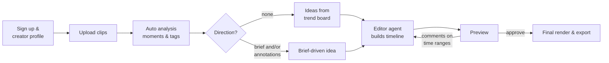

# 01 — Product Plan

> Status: **draft v0.1** · 2026-10-16 · Scope decided with the founder: **multi-tenant SaaS, fitness creators first, TikTok only for v1.**
> Companion docs: [research](02-research.md) · [architecture](03-architecture.md) · [implementation plan](04-implementation-plan.md) · [decision log](05-decisions.md)

## 1. One-liner

**Content Fabrique turns a creator's raw clips into trend-aware short-form videos.** A Research agent tracks what is working on fitness TikTok right now; an Editor agent cuts the creator's own footage into that format; the creator steers with an optional brief and with comments on the timeline — or lets the agents run free.

## 2. Problem

Fitness creators film a lot: sets, reps, posing, talking-head tips, gym b-roll. Turning that into a short that rides a current trend is slow, repetitive work:

1. **Knowing what is working.** Trending sounds, hooks and formats change weekly. Keeping up means hours of scrolling.
2. **Finding the right moments.** The best pose, the cleanest rep or the strongest hook sits somewhere in minutes of phone footage.
3. **Assembling the edit.** Cutting to the beat, reframing to 9:16, adding title cards and exercise labels, and pacing for retention are skilled, fiddly work.
4. **Iterating.** Every "make the intro snappier" is another round in an editor app.

Most AI video tools solve a neighbouring problem: **long → short clipping** (cutting podcasts or streams into clips) or **captioning**. Assembling *several raw clips* into a *concept-driven* short, such as "best back pose → title card → three exercises cut on the beat", is a less crowded gap. The competitor map is in [research §3](02-research.md#3-editing--rendering-stack-and-competitors).

## 3. Target users

| | Primary (v1) | Later |
|---|---|---|
| **Who** | Solo fitness creators and coaches posting to TikTok several times a week | Small agencies/editors managing several creators; other niches (food, beauty, travel) |
| **Footage** | Phone-filmed workout clips, posing, talking-head tips, progress shots | Same, plus long-form |
| **Pain** | No time or skill to edit; unsure what is trending | Throughput, consistency, approvals |
| **Success for them** | Post more, on-trend, without sitting in an editor | More output per editor-hour |

**Personas**

- **Coach Lisa**, a personal trainer with about 15k followers. She films exercise demos and wants consistent educational series ("How to grow a back 101", "3 mistakes on the lat pulldown").
- **Physique Max**, a bodybuilding creator with about 120k followers. He posts posing clips, gym vlogs and transformation edits, all music-driven and trend-heavy.

## 4. Product principles

1. **Creator footage first.** We edit real clips. v1 has no generative "fake" footage or avatars.
2. **AI proposes, creator disposes.** Every AI decision is visible, explained and editable. The timeline is the source of truth.
3. **Freedom with optional direction.** The agents give good results with no brief at all, and follow a precise brief exactly when one is given. Direction is never required.
4. **Trend-aware and safe.** Ideas come with evidence (why this should work now). We never put the creator or ourselves at legal risk around music or platform data (see §9).
5. **Fast feedback loops.** First preview within minutes. Comments turn into revisions.
6. **Niche depth over breadth.** Understand fitness: exercises, muscle groups, poses, reps, form, gym environments.

## 5. Domain language

| Term | Meaning |
|---|---|
| **Workspace** | The tenant. One creator, or a team later. Maps to a Clerk organization. |
| **Asset** | An uploaded file (video, audio, image) plus its derived files (proxy, thumbnails, waveform). |
| **Moment** | A time range inside an asset with structured tags ("lat pulldown · rep 3 · clean form", "back double biceps · best lighting"). Created by analysis, by the user or by an agent. |
| **Annotation** | A user remark on a time range of an asset or a render ("best pose", "don't use, bad form", "cut faster here"). Agents treat it as a constraint or instruction. |
| **Trend** | An observed platform signal (sound, hashtag, format, topic) with metrics over time. |
| **Concept** | A reusable format template with slots, e.g. *Hook title over best pose → 3 exercises with on-screen names, cut on the beat → CTA*. |
| **Idea** | A concept instantiated for one creator: hook text, slot→moment mapping, suggested sound, rationale. |
| **Project** | One video being produced. It owns timeline versions and renders. |
| **Timeline** | A declarative JSON edit spec (an EDL). Versioned and immutable per version, it renders deterministically. |
| **Render** | An output video, either a fast low-res preview or the final 1080×1920. |
| **Agent run** | One execution of an agent, with a persisted event log for transparency, debugging and billing. |

## 6. Core user journeys (v1)

1. **Onboard.** Sign up, then set up a creator profile: niche sub-type (bodybuilding, powerlifting, calisthenics, home workouts…), audience, tone, language, on-screen text style, brand colours and fonts, and TikTok handle.
2. **Upload.** Drag and drop many clips at once (phone 1080p/4K, several GB). Uploads resume after a dropped connection, and each clip shows its processing status live.
3. **Library.** A grid of clips with AI tags and moments. Search with "back exercises", "posing", "talking to camera".
4. **Annotate.** Open a clip to get a player with a filmstrip and waveform timeline. Select a range and add a comment or tag. Annotations become hard constraints ("never use") or preferences ("best pose") for the agents.
5. **Trend board.** Trending sounds and formats for fitness TikTok, each with growth, BPM and length of the popular snippet, a "why it works" note and source links. Items can be saved as inspiration.
6. **Ideas.** "Give me ideas", optionally scoped to selected clips, a trend or a sound, returns idea cards: concept, hook, structure, clips to use, sound, and why. Pick one, tweak it, then "Make it".
7. **Brief (optional).** Free text, for example: *"Start with my best back pose with the title 'How to grow a back 101', then the clip of me doing the exercise, cut to a viral song that matches."* The agent turns it into explicit constraints.
8. **Edit & revise.** The agent builds a timeline and a preview renders. The creator comments on time ranges of the preview, or pins a comment to a spot on the frame ("make *this* text bigger"), or uses quick actions (shorter, more energetic, swap clip, change text, change sound). The agent produces a new version, and versions can be compared side by side. This "point at the frame and say what to change" loop is what [FrameJam](https://github.com/moritzkremb/framejam), linked in the README, does for coding agents; here it is built into the product.
9. **Export.** The final render (1080×1920, H.264), caption text and hashtags, plus a **sound cue** when a trending sound must be added inside TikTok (see §9). Later, the export goes to the creator's TikTok inbox as a draft.

## 7. Feature scope

| Feature | Private beta (MVP) | Public v1 | Later |
|---|---|---|---|
| Auth, workspaces | ✅ single-user workspace | Teams (Clerk orgs) | Agency approvals |
| Resumable bulk upload, library | ✅ | | |
| Auto analysis: shots, tags, transcript, quality | ✅ basic | Pose / exercise recognition, rep counting | Custom models |
| Annotations on clip timeline | ✅ | | |
| Trend board (sounds, formats) | ✅ curated formats + web research + creator links | Automated daily scan; licensed music data | Personalised per creator |
| Idea generation | ✅ | | Learning from the creator's performance data |
| Editor agent → timeline → preview/final | ✅ | | |
| Revision via comments and quick actions | ✅ | | |
| Text overlays: title, exercise labels | ✅ | Word-level animated captions | Motion templates |
| Beat-synced cuts | ✅ when a beat grid is available | | |
| Manual timeline tweaks in UI | Reorder, trim, swap, edit text | Fuller editor | |
| Export + sound cue sheet | ✅ | | |
| TikTok draft upload (inbox) | ✅ if TikTok's app review passes in time | ✅ | Direct post (needs audit) |
| Billing, plans, quotas | Manual (invite-only) | ✅ | Usage-based add-ons |
| Instagram Reels / YouTube Shorts | | | ✅ |
| Brand kit, saved templates | | ✅ | Template marketplace |

## 8. Agents (product view)

### Research agent: *"what is working right now?"*
- **Scheduled mode.** A daily scan of fitness TikTok signals (sounds, hashtags, formats/hooks, topics) feeds the shared trend board. It is shared across tenants, so the cost is amortised.
- **On-demand mode.** "Which format fits these clips?" or "find a sound for this energy/BPM".
- **Output.** Trend records with snapshots, concepts (format templates with slots), and evidence links.
- **Hard rule.** It only uses data sources whose terms allow our use. The approved sources are in [research §1](02-research.md#1-tiktok-trend-data-and-music-licensing).

### Editor agent: *"turn this idea and these clips into a great edit"*
- **Inputs.** Creator profile, idea/concept, optional brief, annotations, clip index (moments), optional sound beat grid.
- **Works through structured tools**: search and view moments, inspect frames, read the beat grid, apply timeline edits, render a preview and look at it. It writes the **timeline**, not raw ffmpeg (see [architecture §6](03-architecture.md#6-timeline-spec-and-renderer)).
- **Escape hatch.** A sandbox with ffmpeg and Python for custom effects that the timeline vocabulary can't express. It is behind a feature flag and billed.
- **Output.** Timeline v*N*, a short explanation of its choices, and open questions if any.

### Later agents
- **Copy agent.** Hooks, on-screen text variants, caption and hashtags. In the MVP this is part of the Editor.
- **Performance analyst.** Reads the creator's own post metrics (with consent) and learns what works for *them*.

## 9. Music and sound strategy

> Grounded in [research §1](02-research.md#1-tiktok-trend-data-and-music-licensing). Summary:

- We **never redistribute copyrighted trending audio** inside exported files by default. Trending sounds are licensed for use *inside* TikTok when the creator picks them there. A file we render with the song baked in is a new copy we have no licence for.
- **Default flow, "cut to the beat, add the sound in TikTok".** The Editor cuts to the sound's beat grid (tempo, beats, drop). Previews play a generated *beat-guide* click track instead of the song. The export carries a *silent or original-audio* track plus a cue: "add sound X, start at 0:12". The creator adds the sound in the TikTok app, either from the draft in their inbox (v1) or when uploading.
- **Licensed-music option.** Music from a stock library whose licence covers our use can be baked in. This suits business accounts, which are limited to commercially cleared music.
- **Creator-supplied audio.** Creators may upload audio they own or have licensed (voice-over, their own music). Our terms make them responsible for their rights.

## 10. Pricing hypothesis

The numbers below are **hypotheses to validate in beta**, anchored on the unit costs in [architecture §13](03-architecture.md#13-cost-model). Competitor prices still need benchmarking ([research §6](02-research.md#6-limits-of-this-research-and-open-questions)).

| Plan | Price (hypothesis) | Includes |
|---|---|---|
| Trial | Free | 3 exported videos, 2 GB storage. Previews are watermarked, exports never are: TikTok forbids API-posting apps from adding promotional watermarks ([research §1](02-research.md#1-tiktok-trend-data-and-music-licensing)) |
| Creator | ~€29 / month | 20 exported videos, 50 GB, trend board, ideas |
| Pro | ~€79 / month | 60 videos, 200 GB, brand kit, priority renders, TikTok drafts |
| Team / Agency | Custom | Several creators, seats, approvals |

**Unit-economics guardrail:** cost of goods per exported video (LLM + compute + storage) must stay **at or below ~25 % of the plan's per-video price at full usage**. For Creator, €29/20 ≈ €1.45 per video, so COGS ≤ ~€0.36. For Pro, €79/60 ≈ €1.32, so COGS ≤ ~€0.33. That matches the architecture target of **< $0.30 per video at v1**. With Claude Opus 5.5 on every edit, COGS is ≈ $1.00–1.20 per video, so reaching the guardrail needs cheaper models on the steps where evals show parity, or higher prices. That is **a founder decision after the P4 evals** ([architecture §13](03-architecture.md#13-cost-model)). The private beta runs at a lower margin on purpose. The plan is credits-based internally, so expensive actions (sandbox runs, many revisions) draw down credits transparently.

## 11. Success metrics

| Level | Metric | Beta target |
|---|---|---|
| North star | Videos exported per active creator per week | ≥ 3 |
| Activation | Sign-ups that export a first video within 24 h | ≥ 40 % |
| Speed | Upload done → first preview | p50 < 5 min |
| Quality | First drafts accepted with ≤ 2 revisions | ≥ 60 % |
| Retention | Creators active in week 4 | ≥ 35 % |
| Economics | COGS per exported video | Measured in beta (≈ $1.00–1.20 expected with Opus 5.5 throughout); < $0.30 by v1 |
| Outcome (later) | Views/engagement vs the creator's baseline | ↑ |

## 12. Non-goals for v1

- Platforms other than TikTok. Exports work anywhere, but trends, presets and publishing target TikTok.
- Long-form → shorts clipping (Opus Clip territory).
- Generative video, AI avatars, AI voice clones.
- A full non-linear editor. We offer focused tweaks; the agent does the heavy lifting.
- Collecting TikTok data in ways its terms forbid.

## 13. Risks

| Risk | Impact | Mitigation |
|---|---|---|
| Music licensing | Legal exposure, muted videos | §9: cue-only by default, licensed library option, clear ToS |
| Trend-data access: no official commercial API; Research API is non-commercial; Creative Center's song chart unavailable in Sept–Oct 2026 | Research agent is starved | Curated concept library + web-search research + creator-supplied links + licensed music analytics; unofficial providers only after legal review, behind one interface; shared across tenants ([D-11](05-decisions.md#d-11-trend-data-sources)) |
| Edit quality below creator bar | Churn | Structured timeline, strong clip analysis, evals from day one, fast revision loop, proven concept templates |
| Cost per video too high | Margin | Cheap deterministic signals first, small models for bulk tagging, prompt caching, proxies for previews, shared research |
| TikTok API/policy changes | Publishing breaks | Export-first design; publishing is an add-on |
| Privacy (EU users, bodies and faces in footage) | Trust, GDPR | EU storage/DB regions, DPAs, retention limits, no training on user content, deletion on request |
| Users uploading content they don't own | Takedowns | ToS, notice-and-takedown process, no public hosting of user media |

## 14. Seed concept library (hypotheses to validate)

Twelve well-known fitness short-form formats, written as **slot structures** the Editor can fill from a creator's clips. They form the curated fallback library (implementation task P5-06). The Research agent adds and re-ranks concepts as trend evidence comes in. Durations are starting points.

| # | Concept | Slot structure (≈ seconds) | Footage needed |
|---|---|---|---|
| 1 | **"How to grow a ___ 101"** (the README example) | Hook: best pose of the target muscle + title card (1.5–2) → 2–4 exercise clips with on-screen names and rep cues, cut on the beat (3–5 each) → end on the pose or a CTA (1–2) | Posing clip, exercise clips |
| 2 | **Stop doing X, do Y** | ❌ wrong-form clip with red label (2–3) → ✅ correct-form clip with green label (3–4) → cue text (1–2) | The same exercise done wrong and right |
| 3 | **3 exercises for ___** | Hook text over the most dynamic rep (1.5) → exercise 1/2/3 with numbering (3–4 each) → recap frame | 3 exercise clips |
| 4 | **Rate my form / form check** | Full rep in slow motion (3–5) → zoomed key moment with annotation (2–3) → verdict text | One clean rep, ideally side-on |
| 5 | **Workout with me / full session** | Fast montage cut on every beat (0.5–1 per clip) → final set in real time → finisher pose | Many short clips from one session |
| 6 | **Transformation / progress** | "Day 1" or old clip (1–2) → beat drop → "Today" pose (2–3) → optional stats text | Old and new physique clips |
| 7 | **POV: ___** (relatable gym moment) | POV text over a situational clip (2–3) → reaction or payoff clip (2–3) | Situational clips, talking head |
| 8 | **Beginner vs advanced** | Split or sequential: beginner variant (3) → advanced variant (3) → tip text | Two variants of a movement |
| 9 | **Myth vs fact** (talking head) | Myth text + talking-head hook (2) → explanation with b-roll cutaways (6–15) → fact card | Talking-head clip + b-roll |
| 10 | **Day N of ___** (series) | Series counter title (1) → highlight reel (5–10) → teaser for tomorrow | Day's clips |
| 11 | **Posing routine** (bodybuilding/physique) | One pose per beat, mandatory poses with labels (1–2 each) → hold on the best pose | Posing clips |
| 12 | **What I eat / prep with me** (light lifestyle) | Hook plate shot → quick cuts of prep on beats → macro text card | Food/prep b-roll |

Each concept stores: slot roles, text roles (title, label, CTA), pacing rules (cuts per beat, minimum shot length), preferred sound energy and tempo range, and evidence links when it comes from the Research agent.

## 15. Roadmap at a glance

Detailed phases are in the [implementation plan](04-implementation-plan.md).

| Milestone | What creators can do | Rough timing (1–2 engineers + Claude Code) |
|---|---|---|
| M0 Foundations | Sign in; see the dashboard shell | weeks 0–2 |
| M1 Library | Upload, browse, annotate clips | weeks 2–5 |
| M2 Understanding | Search their footage by meaning | weeks 4–8 |
| M3 First edits | Get an agent-made edit from a brief and revise it | weeks 6–11 |
| M4 Trends & ideas | Browse trends; get ideas that use their clips | weeks 10–13 |
| M5 Private beta | Export, TikTok drafts, plans and limits; 10–20 creators onboarded | weeks 13–17 |
