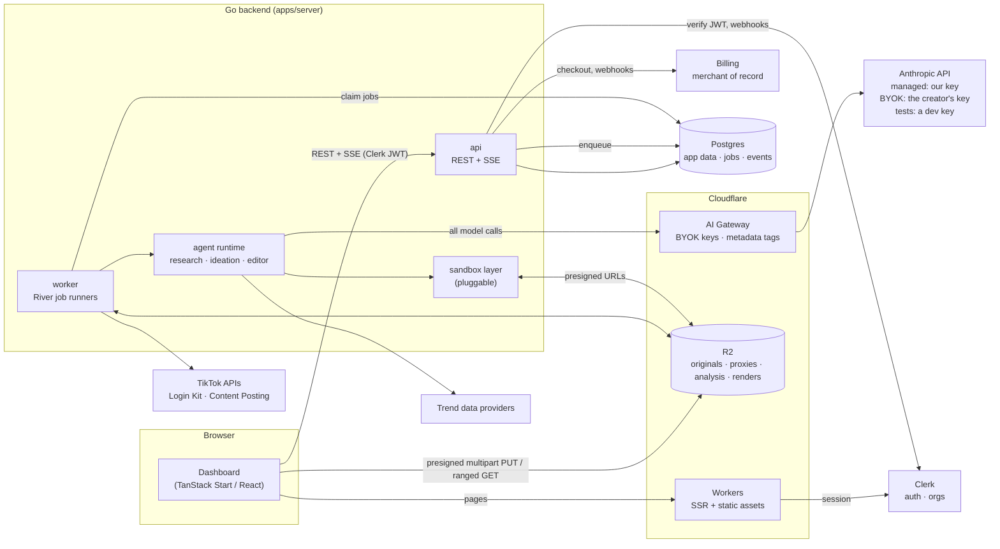
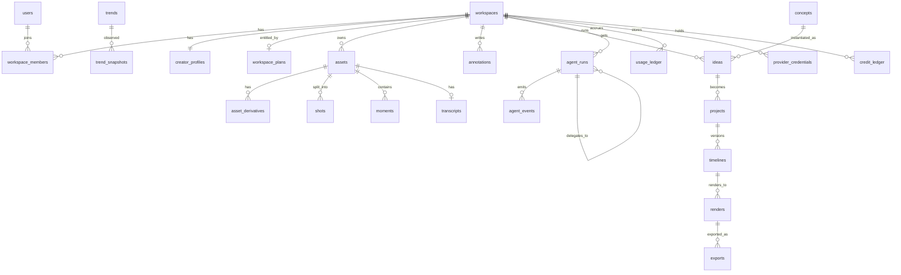
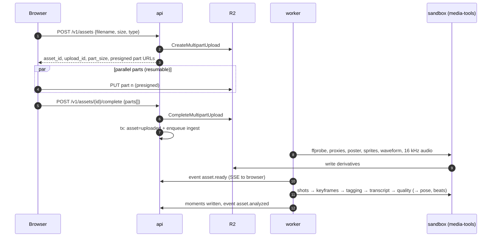
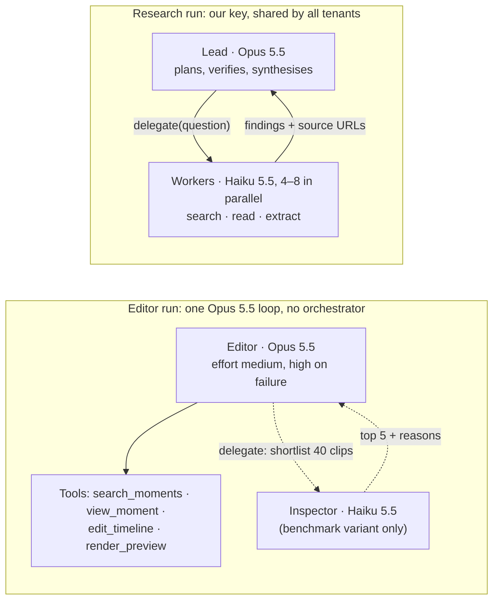

# 03 — Technical Architecture

> Status: **draft v0.1** · 2026-10-16
> This document describes the *shape* of the system. Technology choices and their rationale live in the [decision log](05-decisions.md) (`D-xx`), with evidence in the [research report](02-research.md).

## 1. Goals and constraints

- **Multi-tenant SaaS** for fitness creators; TikTok-only in v1 ([product plan](01-product-plan.md)).
- **Agents must be steerable and reliable**: deterministic rendering, an inspectable edit spec, clear cost caps.
- **Media heavy**: multi-GB uploads, CPU-bound analysis and rendering, smooth scrubbing in the browser.
- **Planned stack**: TanStack Start (`apps/web`), Go (`apps/server`), Cloudflare (R2, Workers), Clerk, a pluggable agent sandbox. Cloudflare K2 only if a real need appears ([D-05](05-decisions.md#d-05-realtime-updates-sse-from-go-k2-deferred)).
- **EU-first**: the founder and early users are EU-based, so data stays in EU regions where the vendor allows ([D-15](05-decisions.md#d-15-eu-data-residency)).
- **Who pays for tokens is per workspace**: either managed credits (we call Claude with our key) or the creator's own Anthropic key ([D-18](05-decisions.md#d-18-who-pays-for-tokens-managed-credits-or-bring-your-own-key)).
- **Model choice is data, not code**: routing profiles tuned by benchmark ([D-17](05-decisions.md#d-17-model-routing-is-data-tuned-by-benchmark)).
- **Every model call goes through the AI Gateway, and testing is self-funded**: development, CI and benchmarks use a `cf-dev` gateway with a development key, and customer traffic uses the production gateway on our key (managed) or the creator's key (BYOK) ([D-21](05-decisions.md#d-21-testing-on-the-first-party-api-self-funded)).

## 2. System overview



**Request path.** The browser talks to Cloudflare Workers for pages and to the Go API for data. Media bytes never pass through the API: the browser uploads to R2 with presigned URLs and plays proxies straight from R2.

**Work path.** The API writes rows and enqueues jobs **in the same Postgres transaction**. Workers claim jobs, process media, run agents and append events. The API streams those events to the browser over SSE.

## 3. Components

| Component | Runs on | Responsibility |
|---|---|---|
| `apps/web` | Cloudflare Workers ([D-09](05-decisions.md#d-09-hosting)) | Dashboard UI, SSR, Clerk sign-in, upload client, player/timeline UI |
| `api` (Go binary) | EU servers behind Cloudflare Tunnel ([D-09](05-decisions.md#d-09-hosting)) | REST API (OpenAPI 3.1), SSE, presigning, webhooks (Clerk, billing, TikTok), quota checks |
| `worker` (Go binary) | EU servers; horizontally scalable; burst to Cloudflare Containers | Job runners: ingest, analysis, render, agent runs, trend scans, cleanup |
| `media-tools` image | `hardened` sandbox (gVisor) on the workers; also the base for the agent escape-hatch sandbox | ffmpeg 8 + Python tools (scene detection, MediaPipe pose, Beat This! beat tracking, transcription). Only permissive licences ([D-16](05-decisions.md#d-16-licensing-policy-for-ml-and-media-components)) |
| `sandbox-gateway` Worker | Cloudflare Workers | Thin shim the Go `cloudflare` sandbox provider calls to create, exec in and destroy Cloudflare Sandboxes; holds the R2 credentials (`S3Gateway`) |
| Postgres | Managed ([D-01](05-decisions.md#d-01-database-postgres-from-day-one-skip-d1-for-the-go-backend)) | System of record, job queue (River), agent event log |
| R2 | Cloudflare | All media and large artefacts |
| Clerk | SaaS | Users, sessions, organizations (workspaces) |
| Billing | Merchant of record: Stripe MoR or Paddle ([D-13](05-decisions.md#d-13-billing)) | Checkout, subscriptions, EU VAT and sales tax; webhooks → plans and entitlements in Postgres |
| AI Gateway | Cloudflare ([D-19](05-decisions.md#d-19-model-gateway-cloudflare-ai-gateway-in-byok-mode-openrouter-optional)) | Front door for every model call: our Anthropic key, the creator's or the development key, analytics, spend limits as a backstop, payload logging off |
| Model APIs | SaaS | Claude for agents and tagging, called with our key (managed) or the creator's key (BYOK, [D-18](05-decisions.md#d-18-who-pays-for-tokens-managed-credits-or-bring-your-own-key)) through the gateway. Tests use the same API through the dev gateway with a development key ([D-21](05-decisions.md#d-21-testing-on-the-first-party-api-self-funded)). A video-native model only where it wins ([D-10](05-decisions.md#d-10-video-understanding)) |

### Repository layout

```
package.json  bun.lock     # bun workspace: apps/web (@cf/web) + packages/*
go.work                    # Go workspace: apps/server
Taskfile.yml  compose.yaml # `task dev`; local Postgres (pgvector) and MinIO (stands in for R2)
scripts/                   # dev.sh, run by `task dev`
.editorconfig
apps/
  web/                     # TanStack Start app (dashboard), package @cf/web
  server/                  # Go module github.com/nilpntr/content-fabrique
    cmd/
      api/                 # HTTP API + SSE
      worker/              # River workers (ingest, analysis, render, agents, trends)
      cfctl/               # admin CLI: migrate, seed taxonomy, replay agent runs, run evals and benchmarks
    config/
      routing/             # versioned model-routing profiles (YAML) and models.yaml, the model-name map
    internal/
      config/ telemetry/   # env config, slog + OpenTelemetry
      httpapi/             # server, CORS, error body, health; middleware (tenancy, rate limit)
      api/                 # GENERATED from packages/schemas/openapi.yaml: models + strict server interface (P0-08)
      auth/                # Clerk JWT verification, Clerk webhooks (Svix)
      store/               # pgx pool, repository functions, goose migrations (migrations/), sqlc queries (queries/) and generated code (db/)
      ids/                 # TypeID <-> UUIDv7 helpers and the typed IDs (WorkspaceID, UserID), D-24
      jobs/                # River: client setup, job args, worker registration, periodic jobs, River UI, River's migrations
      storage/             # R2 (S3 API) client, presign, multipart, key layout
      media/               # ffprobe/ffmpeg wrappers: proxies, sprites, waveforms, keyframes
      analysis/            # shots, tagging, transcription, quality, pose; moment builder
      timeline/            # spec types, JSON Schema, validation, edit ops, diff
      render/              # timeline → ffmpeg compiler, profiles, text & captions
      agents/
        runtime/           # loop, tool registry, budgets, events, cancellation, delegate (sub-agents)
        llm/               # provider interfaces; Anthropic impl; router + routing profiles; client factory (managed / BYOK); video-model impl
        editor/ research/ ideation/
      trends/              # provider adapters, normalisation, snapshots
      sandbox/             # Provider interface + implementations
      events/              # event log + SSE broker (LISTEN/NOTIFY)
      billing/             # plans, quotas, usage + credit ledgers, price table
      secrets/             # envelope encryption and custody for BYOK keys
      bench/               # benchmark harness behind `cfctl bench`
      tiktok/              # Login Kit OAuth, Content Posting API client
packages/
  schemas/                 # timeline JSON Schema + OpenAPI spec (single source of truth); api/schema.ts is generated from the spec
  media-tools/             # Dockerfile + Python CLI for the media/sandbox image
infra/                     # IaC: Cloudflare (R2, DNS, Workers), backend hosts
.env.example               # every variable the stack reads; sources in docs/06
docs/
```

## 4. Data model

Postgres, every tenant-owned row carries `workspace_id`. IDs are UUIDv7, generated by Postgres 18's `uuidv7()` (the column default), which is time-sortable; the API and the timeline spec show them as TypeIDs such as `ast_01j…` ([D-24](05-decisions.md#d-24-public-ids-are-typeids-over-uuidv7)). Simplified:



| Table | Key columns (abridged) |
|---|---|
| `workspaces` | `id`, `clerk_org_id`, `name`, `region`, `billing_mode` (managed, byok). There is no plan column: the plan lives in `workspace_plans` |
| `workspace_plans` | `workspace_id` (primary key, one row per workspace), `plan` (none, trial, studio, creator, pro), `status` (active, past_due, canceled), `source` (manual, merchant), `current_period_end` (null: does not end), `granted_by` |
| `users`, `workspace_members` | `clerk_user_id`, `email`; `role` (owner, editor, viewer) |
| `creator_profiles` | `niche` (jsonb: sub-niches), `audience_regions`, `tone`, `language`, `brand` (fonts, colours, logo asset), `defaults` (caption style, fps) |
| `assets` | `kind` (video, audio, image), `title`, `description`, `tags[]` (from the quick look, P1-04b; the title is editable), `status` (uploading → uploaded → processing → ready / failed), `filename`, `content_type`, `r2_key`, `size_bytes`, `sha256`, `failure_reason`, `created_by`, `deleted_at`, and, written by the ingest (P1-04), `duration_ms`, `width`, `height` (upright, after the rotation), `fps`, `rotation` (degrees clockwise the stored picture needs), `video_codec`, `audio_codec`, `has_audio`, `hdr`, `probe` (the normalised ffprobe result, no tags), `ingest_progress`, `ingest_stage` |
| `uploads` | `workspace_id`, `asset_id` (unique: one upload per asset), `r2_upload_id`, `part_size`, `part_count`, `expires_at`, `completed_at`, `aborted_at` (multipart state for resume) |
| `asset_derivatives` | `workspace_id`, `asset_id`, `kind` (proxy_720, proxy_360, poster, sprite, sprite_vtt, waveform, audio_16k, keyframe, hover_preview; unique per asset), `r2_key`, `content_type`, `size_bytes`, `meta` (dimensions, duration, tile layout) |
| `shots` | `asset_id`, `idx`, `start_ms`, `end_ms`, `keyframe_key`, `signals` (blur, exposure, motion) |
| `moments` | `asset_id`, `start_ms`, `end_ms`, `source` (analysis, user, agent), `labels[]`, `attrs` (exercise, muscle_group, pose, rep_index, framing, quality), `description`, `search` (tsvector), `embedding` (optional, [D-10](05-decisions.md#d-10-video-understanding)) |
| `transcripts` | `asset_id`, `speech`, `language`, `words` (jsonb: text, start_ms, end_ms, confidence), `structure` (jsonb: sentences, fillers, pauses over 400 ms), `provider`, `model`, `audio_ms`, `speech_ms`. A clip checked and found without speech has a row with `speech = false`. `assets.transcript_status` is `none`, `pending`, `no_speech`, `ready` or `failed` (P2-05, [D-27](05-decisions.md#d-27-transcription-whispercpp-locally-workers-ai-whisper-when-hosted)) |
| `annotations` | `target_type` (asset, render, timeline_version) and `target_id` (a plain uuid; the target is looked up per type, in the caller's workspace, before a row is written), `project_id` and `timeline_version` (set from the render or version, null for a clip; composite foreign keys keep them inside the workspace), `start_ms`, `end_ms` (a moment has `end_ms = start_ms`), optional `pin` (normalised x/y point or x/y/w/h box on the frame, FrameJam-style), `kind` (comment, include, exclude, prefer, instruction), `body` (at most 2,000 characters, cleaned like a brief), `status` (open, applied, resolved), `parent_id` (replies, one level), `author_kind` and `author_id` (a usr_ TypeID, or the editor run), `applied_in_run_id`, `addressed_in_version`, `deleted_at` (soft). The app role cannot DELETE |
| `trends`, `trend_snapshots` | `kind` (sound, hashtag, format, topic), `external_id`, `title`, `meta` (bpm, snippet window, region); snapshots: `observed_at`, `rank`, `metrics`, `source` |
| `concepts` | Global or per-workspace format templates: `structure` (slots, durations, text roles), `evidence`, `tags` |
| `ideas` | `concept_id`, `hook`, `rationale`, `slot_plan` (slot → moment candidates), `sound_trend_id`, `status` |
| `projects` | `idea_id`, `title`, `format` (9:16, 1:1, 4:5, 16:9, [D-25](05-decisions.md#d-25-output-formats-916-11-45-and-169-per-project)), `brief`, `status` (draft, editing, review, approved, exported), `current_timeline_id` |
| `project_assets` | `project_id`, `asset_id`, `position`: the footage the creator selected in the new-project flow (P4-04b); the editor only uses these |
| `timelines` | `project_id`, `version`, `spec` (jsonb), `schema_version`, `parent_id`, `author` (user or run), `change_summary`. Immutable once written. |
| `renders` | `project_id`, `timeline_version` (the immutable version rendered; composite foreign keys keep both inside the workspace), `profile` (preview, final), `status` (queued, rendering, ready, failed), `progress`, `stage`, `mp4_key`, `contact_sheet_key`, `time_map_key` (and their sizes), `duration_ms`, `width`, `height`, `contact_sheet` (the tile layout), `sound_cues`, `wall_ms`, `cpu_ms`, `failure_reason`, `requested_by_kind` and `requested_by_id` (a user or an agent run), `objects_purged_at`. One render per version and profile that is queued, rendering or ready (partial unique index); the time map is the object `time_map.json` |
| `agent_runs` | `agent` (research, ideation, editor, worker), `parent_run_id` (sub-agent runs), `status` (queued, running, waiting_input, succeeded, failed, cancelled), `input`, `output`, `routing_profile`, `model`, `effort`, `escalated` (bool), token counts, `cost_micros`, `budget_micros`, `billed_to` |
| `agent_events` | `run_id`, `seq`, `type` (status, progress, tool_call, tool_result, message, artifact, error), `payload`. Streamed to the UI. |
| `usage_ledger` | `kind` (llm, render_seconds, analysis_minutes, storage_gb_days, sandbox_seconds), `quantity`, `billed_to` (platform, workspace_key, test), token counts (input, cache_write, cache_read, output), `list_cost_micros`, `price_table_version`, `ref` |
| `provider_credentials` | `workspace_id`, `provider` (anthropic), `label`, `key_ciphertext`, `key_version`, `key_last4`, `status` (active, invalid, revoked), `validated_at`, `last_used_at`, `created_by` (BYOK keys; [§11a](#11a-model-access-managed-credits-or-byok)) |
| `credit_ledger` | `workspace_id`, `kind` (grant, spend, expire, refund, top_up), `credits`, `action` (first_edit, revision, ideation…), `usage_ref`, `created_at`. Append-only. |
| `integrations` | `provider` (tiktok), `external_account_id`, `scopes`, encrypted tokens, `expires_at` |
| `exports` | `render_id`, `destination` (download, tiktok_draft), `status`, `external_id` |

**Schema v1 (P0-05).** The first four tables are `workspaces` (`clerk_org_id` unique), `users` (`clerk_user_id` unique), `workspace_members` (primary key on both ids, `ON DELETE CASCADE` from either side) and `creator_profiles` (one row per workspace, created on first save). The ids default to `uuidv7()`, so inserts let the database make them (`uuid_extract_timestamp(id)` returns the creation time), and a trigger keeps `updated_at` current. `region` is free text with the default `eu`; `billing_mode` and `role` are check-constrained. Migrations are goose files embedded in the binary and run by `cfctl migrate` as the schema-owning role. Each one calls `cf_grant_app_dml('table')` to give the database's group role `<database>_app` (`cf_app` locally; the app's login role belongs to it) `SELECT, INSERT, UPDATE, DELETE` on its new tables and nothing else ([setup guide §3.4](06-setup-and-credentials.md#34-postgres)). sqlc compiles `store/queries/*.sql` against these migrations into `store/db`, using the typed IDs for key columns.

**Plans and the paywall (P0-16).** `workspace_plans` (migration 00005) is the one source of truth for what a workspace may use, and it replaced the free-text `workspaces.plan` column, which is dropped, so nothing has to be kept in step. A workspace has no row until its first grant, and a new workspace gets no plan (no automatic trial): it sees the paywall. A plan is **active** when `plan <> 'none'`, `status = 'active'` and `current_period_end` is null or in the future; the query that reads it decides this with the database clock on every request, so an expired `--until` stops working at that instant with no job, and a revoke is effective on the next call. Until the merchant of record arrives (P7-01, [D-13](05-decisions.md#d-13-billing)) a person sets it with `cfctl plan grant|revoke|show` (`source = manual`, `granted_by = cfctl:<operator>`), which finds the person by e-mail or Clerk user id, takes their workspace (several: `--workspace` is required and the candidates are listed by name and id) and connects with `DATABASE_URL`, the app role, so a grant needs DML and no DDL. `GET /v1/me` carries `entitlements` (`plan`, `status`, `active`, `current_period_end`). **Every `/v1` route is paid-only by default:** `auth.Mount` puts a catch-all on `/v1/` that runs the authentication middleware and then `RequireActivePlan` in front of the `V1` router it returns, so every route added with `V1.Handle` (and a path that no route has) answers 401 without a token and **402** `{"error":{"code":"plan_required"}}` when the workspace has no active plan, before anything else about the request is looked at. Routes are added to that router (`V1.Handle` refuses a pattern outside `/v1/`), never to the shared mux. `/v1/me` never fails because the plan could not be read: it reports `status: "unknown"`, `active: false` and the web app asks the user to retry. The allowlist of routes open without a plan is written out in `internal/auth/entitlements.go` and mounted with authentication alone: `GET /v1/me`, `GET /v1/workspace/plan` (the plan and its limits) and the Svix-signed `POST /v1/webhooks/clerk`, besides the health endpoints. `GET /v1/library/summary` (registered in `cmd/api`) is the first paid-only endpoint. A workspace that is deleted has no entitlements. A record whose `source` is not `manual` is not replaced by `cfctl plan` without `--force`. The web app shows the Paywall instead of every page except Settings when `entitlements.active` is not true.

**Tenancy.** Every query goes through repository functions that take a `WorkspaceID` resolved from the verified token, never from user input. Integration tests assert that cross-tenant reads fail. R2 keys are prefixed by workspace: `ws/{workspace_id}/assets/{asset_id}/original`, `…/proxy_720.mp4`, `ws/{workspace_id}/projects/{project_id}/renders/{render_id}/render.mp4` (with `contact_sheet.jpg` and `time_map.json` beside it), with the ids in their TypeID form (`ws/wks_01j…/assets/ast_01j…/original`). The server builds a key from ids (`internal/storage`) and a client never names one.

## 5. Media pipeline



**Upload.** S3-compatible multipart upload straight to R2, with presigned part URLs from the API. P1-01 built the API side (`internal/assets`, `internal/storage`); the browser's upload manager is P1-02.
- **Limits** ([research §5.3](02-research.md#53-r2-storage)): parts of 5 MiB–5 GiB, up to 10,000 parts. The server cuts every file into parts of 16 MiB (the limit is 20 GiB per file, which is 1,280 parts; a compile-time check keeps the largest file within 10,000 parts) and tells the client the part size and count. Accepted types: `video/mp4`, `video/quicktime`, `video/webm`, `audio/*`, `image/jpeg`, `image/png`, `image/heic`.
- **CORS:** the bucket needs a rule allowing `PUT` from our web origins and **exposing the `ETag` header**, because completing a multipart upload needs every part's ETag.
- **Resume:** the client keeps the `asset_id` (the `upl_` id is in the state too) and, after a reload, calls `GET /v1/assets/{id}/upload`, which answers from the database (part size and count, expiry) and from `ListParts` (the parts R2 holds, with ETag and size). It uploads the parts that are missing, with fresh URLs from `POST /v1/assets/{id}/parts`, and completes. R2's own upload id is only inside the signed URLs.
- **Part URLs** are presigned `PUT`s that expire after 15 minutes. `Content-Length` is part of the signature, so a URL only accepts a part of exactly the announced size (the last part is the remainder). The first 20 URLs come with the create call; `/parts` gives up to 100 more at a time.
- **Complete** (`POST /v1/assets/{id}/complete`, parts with their ETags): the server compares the list with `ListParts` (all `part_count` parts, the right sizes, the same ETags; S3 itself would accept gaps), calls `CompleteMultipartUpload`, checks with `HeadObject` that the object is exactly `size_bytes`, and in one transaction marks the upload completed, the asset `uploaded` and enqueues the `asset_ingest` job. A size mismatch fails the asset and queues the object's deletion. If the completion loses a race to an abort, a delete or the expiry job (storage finished, the database refuses), the object it just made is deleted at once and the answer is 409 `upload_not_active`. A completion whose answer was lost is finished by the retry (the upload is gone, the object is there), and a second completion answers 200 with the same asset. The ingest that follows is described below.
- **Roles and limits:** owners and editors may upload, complete, abort and delete; viewers only read (403 `insufficient_role`). A workspace can have 25 uploads in progress (429 `too_many_uploads`); the count and the insert run under a per-workspace advisory lock, so the cap holds however many creates race. A request body is capped at 2 MiB.
- **Clean-up:** the periodic job `uploads_expire` (every 15 minutes) aborts uploads past their `expires_at` (24 hours after they started) in R2 and marks the rows aborted and the asset `failed` (`upload_expired`). If the multipart upload is already gone and an object is there although the database never saw the completion, the job queues that object's deletion (`asset_object_delete` accepts deleted and failed assets, never a live one). The bucket's lifecycle rule (abort incomplete uploads after 1 day) is the backstop. A worker started without the `R2_*` settings snoozes these jobs (no attempt is used) until one that has them picks them up. Deleting an asset, or aborting its upload, hides it at once (soft delete) and enqueues `asset_object_delete`, which removes every object under `ws/{workspace}/assets/{asset}/` (and only when the asset is deleted in that workspace). The ingest job skips an asset that was deleted while it waited.
- **EU buckets** are presigned against the EU jurisdiction endpoint ([D-15](05-decisions.md#d-15-eu-data-residency)).

**Ingest** (P1-04, `apps/server/internal/ingest`, run by the `asset_ingest` job on its own `media` queue). Produces everything the UI needs to scrub smoothly. The job is unique per asset, and a re-run replaces the derivatives (fixed file names, upserted rows; rows of kinds the new run does not make are removed).
- **Steps.** Claim the asset (`uploaded` → `processing`; a deleted or failed asset, or one of another workspace, ends the job), stream the original from R2 into a per-job directory (size checked against the row), `ffprobe` and validate it in the sandbox, decode its first frames (a video ffmpeg cannot decode fails here, quickly), transcode the proxy, make the other picture derivatives **from the proxy** (small, already upright and SDR), extract the audio, upload everything under `ws/{workspace}/assets/{asset}/`, and in one transaction mark the asset `ready` with its probed facts and replace its `asset_derivatives` rows. The worker never opens the original itself: every ffprobe and ffmpeg run is a sandbox job (the provider is `MEDIA_SANDBOX_PROVIDER`, [D-08](05-decisions.md#d-08-sandbox-pluggable-interface-default-provider)), and what comes out of the sandbox is checked (regular files only, size caps, the WAV header is validated before peaks are read).
- `proxy_720.mp4`: H.264 High, 8-bit 4:2:0, **720 px on the short side of the upright picture** (a portrait clip is 720x1280; a smaller source is not scaled up), the rotation applied and the display matrix gone, SDR BT.709 limited range (tagged in the stream), a **constant frame rate** (the source's, rounded up to a whole number) with `-g fps -keyint_min fps -sc_threshold 0`, so a **keyframe lands exactly every second**, `+faststart`, no metadata (a phone's location tags stay behind). Smooth seeking in a plain `<video>`, cheap to render previews from.
- **HDR → SDR.** PQ and HLG sources are scaled first, then tone mapped in linear light with zimg (`zscale` → `tonemap=hable`) to BT.709; the input colour description is passed explicitly, so a file with incomplete tags still converts. SDR sources tagged BT.601 or BT.2020 are converted to BT.709 the same way; untagged ones count as BT.709.
- **Audio.** The stream comes from the probe's `selectedAudio` (default-flagged and decodable, else the first decodable one) and is mapped by index: the `apac` spatial-audio track an iPhone adds next to the AAC one is never touched. The proxy gets that stream as AAC (down-mixed to stereo if it has more channels); a file with no decodable audio gets none, and `has_audio` is false. If the track will not encode, the proxy is made again without it.
- `poster.jpg` (a representative frame at 10 % of the clip), `sprite.jpg` (160 px wide tiles in a grid of up to 100: one tile per second, or per ⌈duration/100⌉ seconds for a longer clip) with `sprite.vtt` (a WebVTT thumbnails track, cues `sprite.jpg#xywh=x,y,w,h`). The stored track names the sheet relatively and cannot work on its own, because the sheet's URL is presigned and expires; `GET /v1/assets/{id}/sprite.vtt` serves the track with every cue rewritten to a fresh presigned URL of the sheet (it needs the bearer token, so the client fetches it and hands the text to the player, for example as a Blob URL for a `<track>`).
- `hover_preview.mp4`: about 8 s made of **four 2 s segments**, each centred in one quarter of the clip (a clip of 8 s or less is used whole), muted, **360 px on the short side**, H.264 with `-crf 30 -maxrate 600k` (so at most about 600 kB) and `+faststart`. The 87 s iPhone clip of the proof run gives 162 kB.
- `waveform.json` (`{version, sample_rate, duration_ms, samples_per_peak, peaks}`: 1000 peaks from 0 to 1, computed from `audio_16k.wav`) for the timeline, and `audio_16k.wav` (mono, 16 kHz, 16-bit PCM) for speech recognition (P2). An audio track that will not extract does not fail the asset; it just has neither.
- **Other kinds.** An `audio` asset gets `audio_16k.wav` and `waveform.json`; an `image` (JPEG or PNG) gets `poster.jpg`. HEIC is not decodable by the image and fails as `unsupported_format`.
- **Validation and failure.** A file the ingest cannot process marks the asset `failed` with a code that is safe to show (`unsupported_format`, `corrupt_media`, `no_video_stream`, `no_audio_stream`, `undecodable_video`, `invalid_duration`, `too_long` (over 30 minutes), `unsupported_resolution`, `kind_mismatch`) and the job ends without a retry. Only a tool that ran and reported a real decode or format error counts as the file's fault. A tool that was killed by a signal (exit 129 to 143, the out-of-memory killer's 137 included), timed out, or could not be run by the sandbox, and a cancelled context, are infrastructure failures: the asset stays `processing`, River retries the job (5 attempts, with backoff), and the proxy is not made again without audio. The last attempt marks the asset `failed` with `processing_timeout` (a job or tool timeout), `processing_interrupted` (the worker was stopped) or `processing_failed`, whatever ended it, using a fresh context for the write. A worker without object storage snoozes the job.
- **Failed assets have no derivatives.** The rule for a re-run that does not succeed: the asset becomes `failed`, its derivative rows go in the same transaction and the objects are removed afterwards (the original stays until the asset is deleted). A re-run that succeeds replaces the rows and objects of its kinds and removes the objects of kinds it no longer makes (a clip that lost its audio track). A run that ends because the asset was deleted removes the derivatives it had already uploaded.
- **Time.** Every sandboxed tool has a timeout that follows the clip: ffprobe and the decode check get 5 minutes, the proxy transcode 3 x the clip's length + 2 minutes (at most 2 hours), and the poster, sprite, hover preview and audio steps a third of the length (5 minutes to an hour). The longest accepted clip is **30 minutes** (`ingest.DefaultMaxDuration`), and with every tool at its limit plus 30 minutes each way for download and upload that is under the **4 hour job timeout** (`ingest.JobTimeout`, River's per-job timeout for `asset_ingest`); `ingest.New` refuses a longer limit that would not fit. River's rescue of stuck jobs is set to 4.5 hours (`jobs.JobRescueAfter`), after the job timeout, so a running ingest is never handed to a second worker. Raising the clip limit means raising the job timeout and the rescue time with it. At start the worker removes `ingest-*` job directories under `MEDIA_TEMP_DIR/ingest` that have not changed for longer than the job timeout (left by a worker that died).
- **Progress.** `assets.ingest_progress` (0–100) and `ingest_stage` (`starting`, `downloading`, `probing`, `proxy`, `derivatives`, `uploading`) are updated at each stage, guarded so a deleted asset stops the job; the API returns them with the asset, and P1-05 streams them.
- **Tenancy.** The job acts with the workspace and asset of its arguments, looks the asset up with both, and refuses a row whose `r2_key` is not the key its ids give. It writes and deletes through a store scoped to that asset's prefix, which has no call that takes a key: a file name that is not a plain name, or is `original`, is refused. If the asset is deleted while the job works, the objects it already wrote are removed again.
- Rotation and colour metadata are normalised; a clip that is HDR, rotated or both comes out as an upright SDR proxy.

**Analysis** turns raw footage into a searchable clip index. The default is a cheap-first hybrid; the choice of models is [D-10](05-decisions.md#d-10-video-understanding).
1. **Shots.** Scene/shot boundaries (PySceneDetect or ffmpeg's `scdet`; TransNetV2 only if its licence passes [D-16](05-decisions.md#d-16-licensing-policy-for-ml-and-media-components)). Most phone clips are one continuous shot, so shots are further split by motion and pose changes.
2. **Signals per shot.** Sharpness, exposure, stability; optionally pose keypoints and rep segmentation for exercise clips (v1).
3. **Tagging.** Sampled keyframes go to a small vision model (Claude Haiku 5.5 by default, validated on eval set #1) with a **fitness taxonomy** (exercise, muscle group, equipment, pose name, camera framing, setting, people count, on-screen text). The output is structured JSON and is validated.
4. **Speech.** Word-level transcript for talking clips (captions, hooks, quotes).
5. **Moments.** Merge the above into `moments` with labels, descriptions, quality scores and full-text search (optional embeddings). User annotations become moments too (`source=user`).

All CPU/ML steps run in the `media-tools` image inside the sandbox layer (§8), because they parse untrusted user files.

## 6. Timeline spec and renderer

**Core design decision ([D-02](05-decisions.md#d-02-edit-representation-declarative-timeline-json--deterministic-renderer)).** Agents and users edit a **declarative timeline (an EDL in JSON)**. A deterministic Go compiler turns it into an ffmpeg graph. The LLM never writes raw ffmpeg in the main path. This gives us:
- **Validation before render** (bad ranges, overlaps, durations, text outside safe zones).
- **Inspectable, diffable versions**, which the UI can show and the user can tweak.
- **Precise revisions**: a comment at 0:04–0:06 of a render maps through `renders.time_map` to the exact timeline item.
- **Reproducibility**: the same spec + assets always give the same output, which makes golden tests possible.
- **Portability**: the same spec can later drive an in-browser live preview or another renderer.

### Spec (v1, abridged)

The full rules for v1, the edit ops and the compiler are in the [timeline design note](design/timeline-v1.md).

```json
{
  "schema": "contentfabrique.timeline/v1",
  "output": { "format": "9:16", "width": 1080, "height": 1920, "fps": 30, "background": "#000000" },
  "tracks": [
    {
      "id": "main", "type": "video",
      "items": [
        {
          "id": "c1", "asset_id": "ast_01j…", "moment_id": "mom_01j…",
          "source": { "in_ms": 3200, "out_ms": 5400 },
          "at_ms": 0, "speed": 1.0,
          "reframe": { "mode": "cover", "focus": { "x": 0.52, "y": 0.40 }, "zoom": 1.08 },
          "look": { "preset": "punchy" },
          "transition_in": { "type": "cut" },
          "audio": { "use_source": false },
          "why": "Best back double-biceps pose; the brief asks to open on it"
        }
      ]
    },
    {
      "id": "text", "type": "text",
      "items": [
        { "id": "t1", "at_ms": 0, "duration_ms": 2200, "text": "How to grow a back 101",
          "style": "title_bold", "anchor": "upper_third", "animation": "pop_in" }
      ]
    },
    { "id": "captions", "type": "captions", "from": "transcript", "style": "word_highlight", "enabled": false },
    {
      "id": "sound", "type": "audio",
      "items": [
        { "id": "s1", "kind": "trend_sound", "trend_id": "trd_01j…", "at_ms": 0,
          "source_offset_ms": 12000, "export": "cue_only", "gain_db": -3 }
      ]
    }
  ],
  "markers": [ { "at_ms": 2200, "kind": "beat", "strength": 1.0 } ],
  "meta": { "idea_id": "ide_01j…", "concept_id": "con_01j…" }
}
```

- **Times are integer milliseconds**, snapped to output frames at compile time. One primary video track in v1; overlays and text go on their own tracks.
- **Audio items have an export policy** ([D-03](05-decisions.md#d-03-music-cue-only-by-default)).
  - `cue_only` sounds are **never reproduced by us**, neither in previews nor in exports. Previews play a generated **beat-guide track** (clicks on beats, accents on downbeats and the drop), so the creator can feel the cut rhythm.
  - `licensed` items (stock library, creator-owned audio) are mixed in normally.
  - The beat grid itself comes from provider metadata (tempo, first-beat offset), from analysis of audio we are allowed to process, or from a tap-tempo fallback in the UI ([research §1](02-research.md#1-tiktok-trend-data-and-music-licensing)).
- **Validation rules** (Go + JSON Schema, shared with the web app via `packages/schemas`): in/out inside the asset duration; no gaps or overlaps on `main` unless intended; minimum shot length; total length within limits; text inside TikTok's UI-safe area; fonts from an allow-list.

### Edit operations

Agents (and the UI) change timelines through **high-level ops**, never by rewriting the whole document. Each call is validated atomically and produces a new immutable version:

`add_clip`, `remove_item`, `move_item`, `trim_item`, `replace_source`, `set_speed`, `set_reframe`, `add_text`, `update_text`, `set_transition`, `set_sound`, `snap_cuts_to_beats`, `set_look`, `set_captions`.

### Renderer

`internal/render` compiles a spec into one ffmpeg invocation per render (`-filter_complex`):
- Per item: `trim/atrim` → `setpts` (speed) → scale/crop to the project's format ([D-25](05-decisions.md#d-25-output-formats-916-11-45-and-169-per-project)) around the focus point → fps conversion → look (`eq`/`curves`/`lut3d`) → transitions (`xfade`).
- Text: `drawtext` for simple text; **ASS subtitles via libass** for styled and animated text and word-highlight captions.
- Audio: source audio and licensed tracks mixed (`amix`/`adelay`/`volume`) and normalised (`loudnorm`).
- **Profiles**:
  - `preview`: 540×960, rendered from proxies, very fast encoder preset, with a watermark. Target: seconds for a 30 s edit.
  - `final`: full size (1080×1920 for 9:16) from originals, high-quality CRF H.264 + AAC, `+faststart`.
  - CPU x264 is enough at our volumes: rendering costs fractions of a cent per short ([research §3.3](02-research.md#33-rendering)).
- Output includes `time_map` (output ms → item id) for comment mapping, and a **contact sheet** (frames at every cut) that the Editor agent uses to check its own work cheaply.
- **Golden tests**: a fixture set of specs rendered in CI, compared by frame hashes or SSIM.

**Render jobs** (P3-06, `apps/server/internal/renderjobs`, the `render` job on the `media` queue; design note [timeline-v1 §6](design/timeline-v1.md#6-compiler-and-renderer-p3-03-p3-05-p3-06)). `POST /v1/projects/{id}/renders` (`{version, profile}`; owners and editors) validates the version against the project's footage as it is now, reuses a render of the same version and profile that is queued, rendering or ready (`200`; a failed one does not count), and otherwise inserts a `queued` row and the River job in one transaction (`202`; at most 5 renders in flight per workspace, `429 too_many_renders`). `GET /v1/renders/{id}` reports `status`, `progress` and `stage` and, once ready, presigned URLs (30 minutes) for the MP4, the contact sheet and the time map, plus the sound cues; `GET /v1/projects/{id}/renders` lists them. The job claims the render, downloads the footage the timeline uses into a job directory (each asset's `proxy_720.mp4` for `preview`, the original for `final`; an audio file has no proxy), runs `render.Compile` and `render.Execute` in the sandbox, makes the contact sheet and the time map, uploads the three files and marks the row ready. Failures follow the ingest's rules: the timeline's or the footage's fault (the version no longer validates, an asset or proxy is gone, ffmpeg refuses the input, the footage is over 8 GiB) fails the render with a reason code and ends the job; the sandbox, storage or a timeout is retried, and the last attempt fails the render (`timeout`, `interrupted` or `processing_failed`) and removes what it uploaded. A project deleted while a render waits or runs ends it (`project_deleted`, nothing left in storage). Renders have a queue of their own (`render`, `RENDER_CONCURRENCY` at once on a worker; previews have priority over finals), so an ingest that runs for hours never holds up a preview. The cap on renders in flight is taken under an advisory lock on the workspace. The periodic job `renders_sweep` (every 5 minutes) fails renders that are queued or rendering without a River job that can still run them (discarded after its last attempt, cancelled or removed: `job_lost`), so that no ghost holds a place in the cap or in the dedupe index, and then removes the objects of failed renders and of ready renders of deleted projects. The Go entry point of the editor agent's `render_preview` is `renderjobs.RenderAndWait`, which returns the ready render (its contact sheet through `Service.ContactSheetJPEG`, its duration in `duration_ms`).

**Later:** an in-browser live preview that plays proxies according to the spec (no server render for small tweaks), and a motion-graphics layer on HyperFrames (HTML-based, Apache-2.0) for richer titles and kinetic captions ([research §3](02-research.md#3-editing--rendering-stack-and-competitors)).

## 7. Agents

### 7.1 Runtime ([D-07](05-decisions.md#d-07-agent-runtime-go-native-loop-on-the-claude-messages-api))

A Go-native agent loop on the Claude Messages API (`anthropic-sdk-go`, using its beta tool runner or a hand-written loop):
- **Tool registry** with typed JSON-Schema tools (`strict: true`). Tool calls and results are persisted as `agent_events` and streamed to the UI ("Looking for your best back pose…").
- **Budgets per run**: token and $ caps (`budget_micros`), a wall-clock timeout and a maximum number of tool calls. They are checked before every model request, and costs go to the `usage_ledger`.
- **Pause and resume**: an `ask_user` tool moves the run to `waiting_input`. The user's reply resumes it. Runs are River jobs, so they survive restarts. The loop is append-only, so a replay rebuilds state from `agent_events`.
- **Prompt caching**: a stable system prompt and tool list come first (cached), and per-run context comes after.
- **Model routing** ([D-07](05-decisions.md#d-07-agent-runtime-go-native-loop-on-the-claude-messages-api), [D-17](05-decisions.md#d-17-model-routing-is-data-tuned-by-benchmark), §7.5):
  - The editor runs on Claude Opus 5.5 (decided).
  - Research uses an Opus 5.5 lead with Haiku 5.5 worker sub-agents.
  - Tagging uses Haiku 5.5, and ideation Sonnet 5.5.
  - Profiles are versioned config, tuned by benchmark.
- **Sub-agents:** a `delegate` tool starts a worker with its own model, tool subset, prompt and budget, and returns a compact structured report (§7.5).
- **Escalation:** a run at the cheaper effort is re-run at the higher effort only when the deterministic hard-constraint checks fail.
- **Per-workspace client:** the loop never holds a key. It asks `llm.ClientFactory` for a client for the workspace's billing mode (§11a).
- **Provider interface** (`agents/llm`), so a second model vendor can be added without touching agent code.

### 7.2 Editor agent

| Tool | Purpose |
|---|---|
| `get_brief()` | Creator profile, idea/concept, brief text, annotations as constraints (include, exclude, prefer), output limits |
| `search_moments(query, filters)` | Full-text and attribute search over the clip index (exercise, pose, quality, asset) |
| `view_moment(id, frames≤8)` | Sampled low-res frames as images, so the model judges visually |
| `get_sound(trend_id)` | Tempo, beats, downbeats, sections, recommended start, licence policy |
| `get_timeline()` | Current spec + validation warnings |
| `edit_timeline(ops[])` | Apply the ops in §6 atomically; returns the new version and warnings ("cut 40 ms off beat") |
| `render_preview()` | Fast preview + contact sheet image for self-checking |
| `ask_user(question, options)` | Only when truly blocked |
| `finish(summary, open_questions)` | Ends the run with an explanation for the UI |
| `sandbox_exec(...)` *(flagged)* | Escape hatch: run ffmpeg/Python in the sandbox to create a derived asset (custom effect) the timeline can reference |

**The revision loop.** A creator's comment on a preview, a time range or a spot pinned on the frame, is stored as an `annotation` on the render. `time_map` resolves it to timeline items. The next editor run receives:
- "comment X applies to item c3 (lat pulldown clip)";
- **the frame image with the pin drawn on it**, so "make *this* text bigger" is unambiguous.

**Built (P1-08).** The open comments of a project (kinds comment and instruction are requests, include/exclude/prefer are standing constraints) reach the run in its context and through `get_comments`, each resolved through the `time_map` of the newest ready render of the version it was made on (`annotations.Resolve`; `internal/agents/editor/comments.go`), with whether each item is still in the current timeline, and with the creator's words in data blocks. When `finish` succeeds the requests the run was handed (those older than the run) become `applied` by that run, with `addressed_in_version` set to the version it made, and the editor answers under each ("Addressed in v3."). The frame image with the pin drawn on it comes later; for now the pin is given as percentages.

It then patches only what is needed. This is the review loop popularised by [FrameJam](https://github.com/moritzkremb/framejam), which the README links to: a reviewer points at the frame and says what to change, and the coding agent gets the timestamp plus an annotated frame over MCP ([research §3](02-research.md#3-editing--rendering-stack-and-competitors)). We build it into the product instead of a local tool.

**Guardrails.** Annotations of kind `exclude` are enforced by the validator, not only by the prompt. Every tool input is schema-validated. User text, transcripts, on-screen text and web content are treated as untrusted data in prompts: they are delimited and never treated as instructions that widen permissions.

### 7.3 Research agent and ideation

- **Daily trend scan** (River periodic job per audience region). The agent calls provider tools ([D-11](05-decisions.md#d-11-trend-data-sources)) and web search, then writes `trends`, `trend_snapshots` and `concepts` with evidence links. Its output is **shared across workspaces**, so its cost is amortised over all tenants.
- **Sound metadata** (tempo, beat grid, popular-snippet window) comes from the provider or from our own analysis of audio we are allowed to process ([D-03](05-decisions.md#d-03-music-cue-only-by-default)).
- **Ideation** is a short structured-output run: creator profile + clip-index summary + trend board → N idea cards, each with a slot → moment mapping (with a `search_moments` tool so ideas only use clips that exist).

### 7.4 Evaluation (quality gates for prompts and models)

Agent quality is the product, so every prompt, model or tool change runs the eval suites (`cfctl eval …`) before release:

| Layer | What is checked | How |
|---|---|---|
| **Analysis** (eval set #1) | Exercise, pose and framing tags; best-moment picks; shot boundaries | Labelled clips → precision/recall per label; cost per footage-minute |
| **Hard constraints** (eval set #2) | The brief's ordering, title and required clips are honoured; `exclude` annotations respected; duration limits; text inside safe zones; cuts within ±1 frame of beats when beat-synced | Deterministic checks on the timeline JSON (no model needed) |
| **Edit quality** | Hook strength in the first 2 s, pacing, clip quality, coherence with the concept, text legibility | LLM-judge rubric (1–5 per dimension) on the contact sheet + timeline, calibrated against human ratings |
| **Research** (eval set #3) | Relevance and novelty of extracted trends and concepts against a human-curated weekly gold list; every evidence link resolves and supports its claim | Gold list + link checker + LLM judge for claim support |
| **Human review** | Would the creator post it? | Weekly blind rating of sampled beta edits; failures added to the eval sets |
| **Efficiency** | $ per run, wall clock, tool calls, revisions needed | From `agent_runs` / `usage_ledger` |

**Gate:** ≥ 80 % hard-constraint pass rate, no regression in judge scores beyond noise, and cost per run within budget.

### 7.5 Model routing, sub-agents and benchmarking

**Routing profiles** (`apps/server/config/routing/*.yaml`) are versioned data. Code asks for a *stage*, never for a model ID. The starting profile follows [D-07](05-decisions.md#d-07-agent-runtime-go-native-loop-on-the-claude-messages-api):

```yaml
profile: v1-start
editor:
  model: claude-opus-5-5
  effort: medium                 # Opus 5.5's default, set explicitly; tuned by D-17
  escalate: { when: hard_constraints_failed, effort: high, max_attempts: 1 }
  subagents:
    inspector: { enabled: false, model: claude-haiku-5-5 }   # benchmark variant only
revision:
  model: claude-opus-5-5
  effort: medium
research:
  lead:    { model: claude-opus-5-5, effort: medium }
  workers: { model: claude-haiku-5-5, max_parallel: 6, budget_micros: 150000 }
ideation: { model: claude-sonnet-5-5, effort: medium }
tagging:  { model: claude-haiku-5-5, batch: true }    # Batch API for backfills: 50 % off
judge:    { model: claude-opus-5-5, effort: high, batch: true }
```

Development climbs a **cheap-first ladder** ([D-22](05-decisions.md#d-22-cheap-first-testing-ladder)). It starts on `dev-cheap`, Haiku 5.5 for every stage (about $0.02 per editor run), until the loop, tools and validators are solid. Then comes `dev-mid` (Sonnet 5.5 for every stage, about $0.33), and only then `v1-start` (Opus 5.5) for a smoke test and the sweeps. Agent-loop tests run with `LLM_MODE=replay`, which serves recorded model calls and costs nothing.

**Model names.** The profiles above use Anthropic's native IDs, such as `claude-opus-5-5`. The direct API and the gateway's `/anthropic` endpoint both take that form. Cloudflare's REST endpoints use `provider/model` names, so the same model is `anthropic/claude-opus-5.5` there (the founder's spelling, which Cloudflare's docs don't show for 5.5 △). `config/routing/models.yaml` maps each native ID to its Cloudflare name, so a profile never changes when the path does. `cfctl doctor` resolves every model in the active profile by its native ID and, when `CF_AI_API_TOKEN` is set, by its Cloudflare name.

**Where sub-agents are used.** They are for *bulk* work that fits a "look into N things, then summarise" shape. The editor is one dependent chain in one context window, so it stays a single Opus 5.5 loop ([D-07](05-decisions.md#d-07-agent-runtime-go-native-loop-on-the-claude-messages-api)).



**The `delegate` tool.**
- **Call:** `delegate(role, task, inputs)` returns a schema-validated report (`summary`, `findings[]`, `sources[]`) plus the worker's cost.
- **Worker:** it runs its own loop with its own model, prompt, **read-only tool subset** and `budget_micros`. Workers run in parallel up to `max_parallel`.
- **Accounting:** each worker is an `agent_runs` row with `parent_run_id`, and its cost rolls up into the parent's budget and the ledger.
- **Failure:** a failed or over-budget worker returns an error report. It never crashes the lead.
- **Trust:** reports are untrusted data. The lead checks central claims against the cited source before it writes `trends` or `concepts`.
- **Caching:** a worker starts a fresh prefix and shares no cache with its parent, because caches are model-scoped. Each worker role has its own stable prompt and tool list, so its prefix caches across runs.
- **Research tools:** workers use the Messages API's server-side `web_search` and `web_fetch` tools (search at about $10 per 1,000). Web fetch only retrieves URLs already in the conversation, so URLs come from search results or the lead's brief.

**Benchmark harness** (`cfctl bench`, protocol and budget in [D-17](05-decisions.md#d-17-model-routing-is-data-tuned-by-benchmark)):

| Part | Design |
|---|---|
| Inputs | Eval sets #1 (analysis), #2 (editor scenarios), #3 (research) and an ideation set, as **recorded fixtures**: pre-analysed clip libraries, so analysis cost isn't paid again |
| Runner | One isolated workspace per cell (scenario × profile × trial). The real renderer runs; the sandbox and TikTok posting are stubbed. Every call's usage is recorded |
| Path | Runs go through the `cf-dev` gateway with the development key: the same path, API and models production uses ([D-21](05-decisions.md#d-21-testing-on-the-first-party-api-self-funded)) |
| Scoring | Deterministic hard-constraint checks first, then the judge rubric (calibrated against ~30 human ratings), then a human "would you post it?" sample |
| Statistics | Mean and p90 cost per *completed* task, pass rate with confidence intervals, quality-versus-cost Pareto frontier |
| Output | A dated report in `docs/benchmarks/` with the table and chart; raw JSONL in R2 |
| Safety | Replays never mutate production state; cost is capped per sweep by a budget approved up front |

## 8. Sandbox layer ([D-08](05-decisions.md#d-08-sandbox-pluggable-interface-default-provider))

Every process that touches untrusted media or runs agent-written commands goes through one interface:

```go
package sandbox

type Provider interface {
	Name() string
	Create(ctx context.Context, spec Spec) (Sandbox, error)
}

type Spec struct {
	Image    string            // e.g. "media-tools:2026.10"
	CPU      float64           // vCPUs
	MemoryMB int
	DiskGB   int
	GPU      string            // "" = none
	Timeout  time.Duration     // hard wall-clock limit
	Env      map[string]string // never long-lived secrets
	Egress   EgressPolicy      // deny-all by default; allow-list (R2 endpoint, model APIs if needed)
	Labels   map[string]string // workspace_id, run_id, job kind (for billing and audit)
}

type Sandbox interface {
	ID() string
	Exec(ctx context.Context, cmd Cmd, out io.Writer) (ExitStatus, error) // streams stdout/stderr
	Download(ctx context.Context, srcURL, dstPath string) error          // pull input via presigned GET
	Upload(ctx context.Context, srcPath, dstURL string) error            // push output via presigned PUT
	WriteFile(ctx context.Context, path string, r io.Reader) error
	ReadFile(ctx context.Context, path string) (io.ReadCloser, error)
	Close(ctx context.Context) error                                      // always destroy; no reuse across tenants
}
```

- **Bytes flow R2 ↔ sandbox directly through short-lived presigned URLs.** The Go worker only passes URLs, so it never proxies gigabytes.
- **Implementations** ([D-08](05-decisions.md#d-08-sandbox-pluggable-interface-default-provider)):
  - `docker`: local development.
  - `hardened`: gVisor (`runsc`) containers on our worker hosts, for **all deterministic media jobs**.
  - `cloudflare`: the Cloudflare Sandbox SDK via the `sandbox-gateway` Worker, the **default for the agent escape hatch**. Internet is disabled, and the job's R2 prefix is mounted with the Worker signing requests, so **no credentials inside**.
  - Alternatives behind the same interface: E2B (Firecracker), and **Claude Managed Agents** for free-form sessions where Anthropic runs the loop. Tools then run in Anthropic's cloud container or on our `hardened` hosts via the Go environment worker.
- **As built in P1-03** (`apps/server/internal/sandbox`): the interface above is the target; v0 ships the smaller one-shot form every media job needs, `Provider.Run(ctx, Job{Image, Args, Mounts, Limits, Network: none}) (Result{ExitCode, Stdout, Stderr, Duration})`, with the `local` (development only, no isolation), `docker` and `hardened` providers. Inputs are read-only mounts under `/in`, the one writable mount is `/work`, and a job without limits is refused. `Create`/`Exec`/`Download`/`Upload` arrive with the `cloudflare` provider.
- **Security**: one sandbox per job (never shared across workspaces); non-root; read-only root filesystem except `/work`; CPU/memory/disk/time limits; egress deny-by-default; no long-lived credentials inside (only presigned URLs scoped to the job's own keys); audit log of every `Exec`.

## 9. API

REST + JSON, contract-first in **OpenAPI 3.1** (`packages/schemas/openapi.yaml`). From it we generate a typed TS client (`openapi-typescript` + `openapi-fetch`, used with TanStack Query) and Go server interfaces (`oapi-codegen`). Auth is a Clerk session JWT in `Authorization: Bearer` ([D-12](05-decisions.md#d-12-auth--tenancy-clerk-organizations-as-workspaces)).

| Area | Endpoints (v1) |
|---|---|
| Me & profile | `GET /v1/me` · `GET/PUT /v1/profile` |
| Assets | `POST /v1/assets` (init multipart) · `POST /v1/assets/{id}/parts` (more presigned parts) · `GET /v1/assets/{id}/upload` (state to resume: part size and count, the parts R2 holds) · `POST /v1/assets/{id}/complete` · `DELETE /v1/assets/{id}/upload` (abort) · `GET /v1/assets` (newest first, cursor) · `GET /v1/assets/{id}` (the asset with its `media` facts, `ingest_progress` and, once ready, a presigned GET URL for each derivative that lives 30 minutes; `GET /v1/assets` carries the same per item) · `DELETE /v1/assets/{id}` |
| Moments & search | `GET /v1/assets/{id}/moments` · `GET /v1/moments?q=…&exercise=…` |
| Annotations | `GET /v1/annotations?target_type=&target_id=` (one clip, render or version) or `?project_id=` (every comment on a project's renders and versions, replies included, oldest first, cursor) · `POST /v1/annotations` (owners and editors; a target or parent of another workspace is `404`) · `PATCH /v1/annotations/{id}` (the author edits anything; another owner or editor may only resolve or reopen; editing an applied comment reopens it) · `DELETE /v1/annotations/{id}` (the author; soft, replies go with it) |
| Trends | `GET /v1/trends?kind=sound\|format&region=…` · `GET /v1/trends/{id}` |
| Ideas | `POST /v1/ideas:generate` → run · `GET /v1/ideas` · `PATCH /v1/ideas/{id}` |
| Projects | `POST /v1/projects` (from idea or brief) · `GET /v1/projects/{id}` · `POST /v1/projects/{id}/edit` (start or continue an editor run with instructions) |
| Timelines & renders | `GET /v1/projects/{id}/timelines` · `GET /v1/timelines/{id}` · `POST /v1/projects/{id}/timelines` (manual ops → new version) · `POST /v1/projects/{id}/renders` (`{version, profile}`) · `GET /v1/projects/{id}/renders` · `GET /v1/renders/{id}` |
| Runs | `GET /v1/runs/{id}` · `GET /v1/runs/{id}/events` (SSE) · `POST /v1/runs/{id}/reply` · `POST /v1/runs/{id}/cancel` |
| Exports | `POST /v1/renders/{id}/exports` (download or tiktok_draft) · `GET /v1/exports/{id}` |
| Stream | `GET /v1/stream` (SSE: workspace-wide events for the dashboard) |
| Webhooks | `POST /v1/webhooks/clerk` · `POST /webhooks/billing` · `POST /webhooks/tiktok` |

**The contract (P0-08).** `packages/schemas/openapi.yaml` is the source of truth; nothing under `apps/server/internal/api` or `packages/schemas/api` is edited by hand. It holds the `bearerAuth` scheme, the shared `Error` schema with the enum of every error code the server answers with, a `pattern` per TypeID ([D-24](05-decisions.md#d-24-public-ids-are-typeids-over-uuidv7)), and every operation with each status it can answer. Webhooks carry the tag `webhooks`: they are documented in the spec but left out of the generated TypeScript types and of the generated Go interface (the Clerk webhook reads the raw body itself).

- **Go.** `oapi-codegen` (pinned as a `tool` in `apps/server/go.mod`) writes the models and a strict `net/http` server interface to `apps/server/internal/api`. `internal/auth` implements it (`apiServer`), and `auth.Mount` registers the generated routes: **a spec operation is paid-only by default** (behind authentication and `RequireActivePlan`, the P0-16 catch-all), unless the spec marks it `x-open-without-plan: true`; `Mount` reads that from the spec embedded in the generated code. Only `GET /v1/me` and `GET /v1/workspace/plan` are open, and a test in `internal/auth` fails when any other operation does not document its `402 PlanRequired` answer. Error codes are the generated `api.ErrorCode` constants, so a code the spec lacks does not compile.
- **TypeScript.** `openapi-typescript` writes `packages/schemas/api/schema.ts` (imported as `@cf/schemas/api`). `apps/web/src/lib/api` wraps it: `openapi-fetch` with the Clerk Bearer token, one `ApiError` for error bodies and lost connections, and thin TanStack Query hooks (`useMe`, `useWorkspacePlan`, `useLibrarySummary`) over the single client that `ApiClientProvider` (in the root route) provides; their keys carry the Clerk user and organization. A 402 `plan_required` from any query or mutation refetches `me`, so the paywall appears without a reload.
- **Adding an endpoint:** (1) describe it in `openapi.yaml`, with every status and error code it can answer (a new code goes in the `ErrorCode` enum); (2) run `task gen:api`, which regenerates both sides, and commit the result; (3) implement the new method of `StrictServerInterface` in `internal/auth` (or its own package that `Mount` is given), and add a client function and hook in `apps/web/src/lib/api`. Decide on purpose whether it opens without a plan (almost never).
- **CI** (the `contract` job) lints the spec with Redocly (`task lint:api`, ruleset `recommended-strict`: any finding fails), runs `task gen:api` and fails on any difference from what is committed, so changing the spec without regenerating fails CI. `task gen` includes `gen:api`.

Conventions: cursor pagination; `Idempotency-Key` on POSTs that create work; `problem+json` errors; per-workspace rate limits and quotas checked before enqueueing.

## 10. Realtime updates ([D-05](05-decisions.md#d-05-realtime-updates-sse-from-go-k2-deferred))

- Workers append to `agent_events` (and small status events for assets and renders) and `NOTIFY` a channel. The API holds SSE connections and forwards matching events per workspace.
- **Resumable**: every event has a monotonically increasing id; clients reconnect with `Last-Event-ID` and the API replays from Postgres.
- **Heartbeats** every ~20 s keep connections alive through proxies. The browser uses a fetch-based SSE client, so the Clerk token can go in the `Authorization` header.
- **Cloudflare K2 is not needed for v1**: event volume is small and already durable in Postgres. Revisit it if we add high-volume analytics events or need fan-out beyond the API instances ([research §5](02-research.md#5-platform-cloudflare-clerk-go-costs)).

## 11. Auth, tenancy, billing

- **Clerk** for sign-up, sign-in and sessions in the web app (TanStack Start SDK). The Go API verifies the session JWT with the Clerk Go SDK v2 (`clerkhttp.RequireHeaderAuthorization`, then `clerk.SessionClaimsFromContext`) and resolves `workspace_id` from the active organization.
- **Clerk webhooks** (Svix-signed, `POST /v1/webhooks/clerk`, the nine events of the [setup guide](06-setup-and-credentials.md#32-clerk)) keep `users`, `workspaces` and memberships in sync. They are processed idempotently and in an order-safe way (P0-07): the `svix-id` of each applied delivery is stored in `webhook_events` in the same transaction as the change, so a replay changes nothing; every write carries the Clerk object's `updated_at` (`clerk_updated_at`) and applies only if it is newer, so an old event cannot overwrite a new one; a membership delete is remembered (and checked, under a per-membership advisory lock, by the webhook and the just-in-time sync alike) so that a stale create, update or older token cannot revive the membership. A signed payload that cannot be used is recorded as `failed` and acknowledged with 200, so Svix does not retry it forever. Clerk's Backend API is never called inside a database transaction. A deleted user or organization is soft-deleted (`deleted_at`; the email is erased, the memberships are removed, the workspace's own data stays) and is never undeleted by a later event.
- **Verifying a request (P0-07).** `internal/auth` wraps the SDK's `WithHeaderAuthorization` (not `RequireHeaderAuthorization`, so that a missing token is a JSON 401 and not an empty 403). It accepts a token only if the signature checks against the instance's JWKS, it has not expired (5 s leeway), the issuer is a Clerk Frontend API, `exp` is present and `azp` equals the `APP_BASE_URL` origin exactly (the SDK's own `AuthorizedPartyMatches` also accepts a token with no `azp`). No active organization is `403 no_active_workspace`; a user removed from the organization is `403 not_a_member`. The key set is fetched at most once per 30 s however many unknown key ids arrive (single flight), and a failing Clerk is `503 identity_unavailable`, not a bad token. The workspace id is looked up from the token's organization and never from request input. **Just-in-time sync:** when the user, the workspace or the membership is not in Postgres yet (always the case on localhost, where webhooks cannot arrive), the middleware fetches the user's email and the organization's name from Clerk's Backend API and upserts them; the role is `owner` for `org:admin`, `editor` for `org:member` and `viewer` for any other Clerk role. Nothing is cached in memory: each request reads one row set from Postgres. Errors have the shape `{ "error": { "code", "message" } }`; the codes are `unauthenticated`, `invalid_token`, `no_active_workspace`, `user_deleted`, `workspace_deleted`, `not_a_member`, `identity_unavailable` (Clerk's API or key set unreachable), `auth_not_configured` (no `CLERK_SECRET_KEY`). The complete list, with the webhook's and the paywall's (`plan_required`), is the `ErrorCode` enum of the [OpenAPI contract](#9-api).
- **CORS (P0-07).** The API allows exactly the `APP_BASE_URL` origin, with `Authorization` and `Content-Type`, and no credentials. A preflight from any other origin, or one that asks for any other header, is answered 403 without CORS headers; every response carries `Vary: Origin`. The health endpoints stay unauthenticated.
- **Billing** ([D-13](05-decisions.md#d-13-billing)):
  - Payments run through a **merchant of record** (Stripe's MoR product or Paddle), which handles EU VAT and sales tax. Clerk stays identity-only.
  - Plans map to quotas (exports per month, storage, concurrent jobs, agent budget).
  - Every billable action writes to `usage_ledger`, and quotas are checked before work is enqueued. Agent runs carry hard `$` budgets.

## 11a. Model access: managed credits or BYOK

Every model call goes through `llm.ClientFactory(workspace)` ([D-18](05-decisions.md#d-18-who-pays-for-tokens-managed-credits-or-bring-your-own-key)):

| | Managed | BYOK |
|---|---|---|
| Key | Platform key from the secret store, in one production Anthropic workspace that has a spend limit as the last backstop | The creator's key from `provider_credentials` |
| Anthropic bills | Us | The creator |
| The creator pays us | A subscription with a credit allowance | A lower platform fee |
| Budgets | Per-run, per-day and per-month credit caps | Per-run $ cap, optional monthly soft cap, plus the creator's own Anthropic workspace spend limit |
| Ledger `billed_to` | `platform` | `workspace_key` |
| Prompt cache | The static prefix is shared across tenants, because caches are per workspace | Per key |
| Rate limits | Ours (we ask for a higher tier) | The creator's tier; new keys start low |

**Testing ([D-21](05-decisions.md#d-21-testing-on-the-first-party-api-self-funded)).** Development, CI and benchmarks go through the `cf-dev` gateway like everything else, using a development key in a dedicated Console workspace that has a monthly spend limit. An empty `ANTHROPIC_BASE_URL` bypasses the gateway, for debugging and before it exists. Keys follow the environment: `production` holds the production key and customers' keys, `staging` its own key, and `local`, `ci` and `bench` only the development key. Test calls write ledger rows with `billed_to = test`, so test spend never mixes into customer margin.

**Gateway ([D-19](05-decisions.md#d-19-model-gateway-cloudflare-ai-gateway-in-byok-mode-openrouter-optional)).** Every model call goes through a Cloudflare AI Gateway in BYOK mode: in production both billing modes, and the development key elsewhere.
- **Client:** the SDK's base URL points at the gateway's Anthropic endpoint, and the provider key travels with the request. Native Anthropic features pass through unchanged.
- **Per-request headers:** `cf-aig-metadata` tags (`workspace_id`, `run_id`, `stage`, `profile`; the limit is five entries) and `cf-aig-collect-log-payload: false`. The gateway then keeps metadata (tokens, model, cost, duration) but not prompts or frames.
- **Guards:** the gateway requires provider credentials, so a request can never fall back to Cloudflare-managed billing. Retries live in our client only. A config flag sends traffic straight to the provider if the gateway is down.

**Key custody (BYOK).**
- **At rest:** `provider_credentials` holds the key envelope-encrypted (AES-256-GCM, a per-record data key, a versioned master key from the platform secret store; a managed KMS later). The API only ever returns the label, last four characters and status.
- **In use:** the key is decrypted only inside the `worker` or `api` process at call time. It is never logged, never written to R2, never put in prompts or tool results, and never sent to a sandbox or the browser. Outbound calls with it go only to `api.anthropic.com`.
- **Access and audit:** only workspace owners can add, replace or remove keys. Every use is audit-logged (workspace, run, model, tokens, never the key).
- **Validation:** on save we call the Models API for the models our profile needs (`claude-opus-5-5`, `claude-sonnet-5-5`, `claude-haiku-5-5`) and refuse a key that can't see them. A later 401 or 403 marks the key `invalid`, pauses that workspace's queued runs and notifies the owner.
- **Rotation and deletion:** add the new key, test it, switch, delete the old one. Deleting a key purges its ciphertext.

**Rate-limit-aware client.**
- A per-key concurrency limiter (a low default for new keys), exponential backoff that honours `retry-after`, and queueing instead of failing.
- Prompt caching on every run: cache reads don't count toward input-token limits.
- Plain-language UI: "Your Anthropic key is on a low rate-limit tier, so runs will queue. Check your tier in the Anthropic Console." (Thresholds change; don't hard-code them.)

**Metering (both modes).**
- Every call writes a `usage_ledger` row: input, cache-write, cache-read and output tokens, `list_cost_micros` from a **versioned price table**, and `billed_to`.
- The same table drives credits in managed mode and the "estimated cost" display in BYOK mode.
- **Credits:** a per-action price list calibrated against realised COGS, written to the append-only `credit_ledger`. The plan allowance resets monthly, and top-up packs are priced at about 3× COGS.
- **Guardrails in both modes:** `budget_micros` per run (enforced by the agent runtime before each model request), a per-workspace daily cap, and an alert when a run exceeds the p99 cost.

## 12. Deployment, environments, observability

- **Environments**: `local` (docker compose: Postgres, MinIO or a dev R2 bucket, worker, api; web via Vite), `staging`, `production`. Separate Clerk instances, R2 buckets and DB branches per environment. Model access follows the environment ([D-21](05-decisions.md#d-21-testing-on-the-first-party-api-self-funded)): `production` and `staging` go through their own AI Gateway, and `local`, `ci` and `bench` through the `cf-dev` one with the development key. Hostnames on `contentfabrique.app`: `contentfabrique.app` and `api.` for production, `staging.` and `api-staging.` for staging ([D-23](05-decisions.md#d-23-product-domain-and-hostnames-contentfabriqueapp)). Environment variables: `.env.example` lists every name. Local values live in `.env`, and staging and production values in `.env.staging` and `.env.production` on the founder's machine and in the CI secret store ([setup guide](06-setup-and-credentials.md)).
- **Hosting** ([D-09](05-decisions.md#d-09-hosting)):
  - Web on Cloudflare Workers.
  - Go `api` and `worker` on EU servers (e.g. Hetzner) as containers, reachable only through **Cloudflare Tunnel**.
  - Workers are horizontally scalable, with per-queue concurrency limits: render and analysis are CPU-bound, agent runs are I/O-bound. The worker's River client listens on the direct database URL; the api only inserts jobs, in the transaction of the write they belong to. River UI runs inside the worker on its own address behind Basic auth (`-river-ui-addr`, staging and local only).
  - When queues back up, burst render and analysis onto Cloudflare Containers with the same image.
- **CI/CD** (GitHub Actions):
  - lint + test for Go and web, render golden tests, and OpenAPI drift check;
  - build the images (`api`, `worker`, `media-tools`) and deploy;
  - Renovate for dependencies;
  - migrations run as a release step, as the schema-owning migrate role (`DATABASE_MIGRATE_URL`): the goose migrations, then River's own tables (`cfctl migrate up` does both and grants the app role DML on them). The app roles on staging and production can read and write rows but not change the schema.
- **Observability**: structured logs (`slog`) + OpenTelemetry traces and metrics. One trace spans API → job → agent turns → sandbox exec. Export goes to a managed backend (e.g. Axiom or Grafana Cloud), with error tracking in the web app. Dashboards: queue depth and latency per job type, render time per output minute, agent cost per run, failures by tool. AI Gateway analytics give a second view of model cost and latency per stage; our ledger stays the source of truth, because gateway cost is a best-effort estimate.
- **Agent observability**: every run has a replayable event log, plus an admin view to inspect prompts, tool calls, cost and the resulting timeline.

## 13. Cost model

These are **modelled estimates** for budgeting. List prices are from October 2026 ([research §5.8](02-research.md#58-cost-model-inputs-oct-2026-list-prices)). The token volumes are assumptions that the benchmark ([D-17](05-decisions.md#d-17-model-routing-is-data-tuned-by-benchmark)) and the `usage_ledger` will replace.

**Testing spend is outside this model.** Development, CI and benchmark runs are the founder's own cost ([D-21](05-decisions.md#d-21-testing-on-the-first-party-api-self-funded)). The COGS and margins below cover customer traffic at list prices.

**Price mechanics that matter** ([prompt caching](https://platform.claude.com/docs/en/build-with-claude/prompt-caching), [batch](https://platform.claude.com/docs/en/build-with-claude/batch-processing)):
- Cache writes cost **1.25×** the input price (5-minute TTL).
- Cache reads cost **0.05×** on Opus 5.5 ($0.20 per MTok) and about 0.1× elsewhere.
- Batch processing takes **50 % off every token**, including cache reads and writes.
- A cache hit needs an identical prefix within the TTL, and caches are isolated per workspace.

### Where an Opus 5.5 editor run spends its money

Worked example for a first edit: ~10 turns; the context grows from ~9k to ~49k tokens as tool results accumulate; ~1.5k output tokens per turn (thinking plus tool calls).

| Component | Tokens | Rate | Cost | Share |
|---|---|---|---|---|
| Cache writes (each token written once) | 49k | $5.00 / MTok | $0.245 | 40 % |
| Cache reads (each turn re-reads the prefix) | 261k | $0.20 / MTok | $0.052 | 9 % |
| Uncached input | ~2k | $4.00 / MTok | $0.010 | 2 % |
| Output (thinking + tool calls) | 15k | $20.00 / MTok | $0.300 | 49 % |
| **First edit, Opus 5.5** | | | **≈ $0.61** | |

The same run costs ≈ $0.33 on Sonnet 5.5 and ≈ $0.02 on Haiku 5.5. A revision (~16k starting context, 4 turns, ~5k output) costs ≈ $0.23 on Opus 5.5. Plausible ranges are $0.45–0.95 for a first edit and $0.15–0.35 for a revision.

**What this says about levers.** About half the cost is output, and about 40 % is cache writes. So effort level, turn count and prefix stability move the bill far more than offloading image viewing to a cheaper model, which would save only ~5 %. That is why the benchmark starts with an effort sweep and escalate-on-failure, not with sub-agents.

### Other units

| Item | Assumption | Estimate |
|---|---|---|
| Ideation | 1 structured run on Sonnet 5.5 with a moment-search tool | ≈ $0.05 |
| Clip tagging | 30 keyframes per footage-minute × ~700 tokens, Haiku 5.5 | ≈ $0.003 per footage-minute; half that through the Batch API for backfills |
| Research agent | Shared across tenants. Opus 5.5 lead, 4–8 Haiku 5.5 workers, ~50 web searches ($10 per 1,000) per region per day | ≈ $1–5 per region-day, never per creator. Our key in both billing modes |
| Rendering | Preview from proxies + final, ~60 s of 4 vCPU | ≈ $0.005 on Cloudflare Containers; less on our own servers |
| Agent escape hatch | Cloudflare Sandbox, 2 vCPU for 5 min | ≈ $0.02 per run |
| Storage | ~5 GB originals + proxies per creator-month on R2 Standard, no egress fees | ≈ $0.08 per creator-month |
| Transcription, shared research, other platform costs | Vendor price not verified | ≈ $0.10 per exported video, all-in |

### Per exported video

One first edit, two revisions, ideation, 10 footage-minutes of tagging, plus the platform costs above:

| Routing | LLM only | All-in |
|---|---|---|
| **Decided start: Opus 5.5 for edits and revisions** | ≈ $1.15 | **≈ $1.25** (range ≈ $0.9–1.9) |
| Opus 5.5 first edit, Sonnet 5.5 revisions | ≈ $0.95 | ≈ $1.05 |
| Sonnet 5.5 for edits and revisions | ≈ $0.65 | ≈ $0.75 |
| Sonnet 5.5 first edit, Haiku 5.5 revisions | ≈ $0.45 | ≈ $0.55 |
| Haiku 5.5 throughout | ≈ $0.10 | ≈ $0.20 |

### Who pays, and what margin that leaves

| | Managed | BYOK |
|---|---|---|
| LLM, ≈ $1.15 per video | Us | The creator, on their Anthropic bill |
| Platform, ≈ $0.10 per video | Us | Us, covered by the platform fee |

Illustrative plan economics. These are **hypotheses**: €1 ≈ $1.15, 21 % VAT, a merchant-of-record fee of 5 % + $0.50 (an unverified third-party figure), and COGS from the table above at full plan usage.

| Plan | Price | Includes | Net revenue | COGS at full use | Gross margin |
|---|---|---|---|---|---|
| Studio (BYOK) | €25 / month | 60 exports | ≈ $22 | 60 × $0.10 = $6 | ≈ 73 % |
| Creator (managed) | €59 / month | 15 videos | ≈ $52 | 15 × $1.25 = $19 | ≈ 64 % |
| Pro (managed) | €129 / month | 40 videos | ≈ $115 | 40 × $1.25 = $50 | ≈ 56 % |

A creator who posts 15 videos a month pays about €40 on BYOK (€25 plus ≈ $17 to Anthropic) against €59 managed. The ≈ €19 difference is the price of convenience. Credit caps keep heavy managed users from turning the margin negative.

**Targets.**
- Managed plans: realised COGS at or below about **40 % of credit value**. The earlier "< $0.30 per video" target is dropped, because the founder chose Opus 5.5 for editing.
- Private beta: managed credits with a hard cap per creator, so exposure is bounded (20 creators × 15 videos × $1.25 ≈ $375 a month).

**Levers, in the order the benchmark pulls them** ([D-17](05-decisions.md#d-17-model-routing-is-data-tuned-by-benchmark)):
1. Prompt-prefix stability and caching.
2. Effort level.
3. Escalate on failure: cheap pass first, re-run at higher effort only if the validators fail.
4. Fewer, denser turns: contact sheets instead of many `view_moment` calls.
5. Batch API for non-interactive work (tagging backfills, judge calls, research evals): 50 % off.
6. Sub-agents for bulk reading (research, and the editor's optional inspector).
7. Cheaper models for revisions and ideation, one notch at a time.

## 14. Security and privacy

- **Data**: the EU region for the database and R2 where available ([D-15](05-decisions.md#d-15-eu-data-residency)); encryption at rest (provider default) and in transit; short-lived presigned URLs; no public buckets.
- **Secrets**: only in the API and worker; never in sandboxes or prompts; rotated through the platform secret store. The development key exists only in `local`, `ci` and `bench`, never in production ([D-21](05-decisions.md#d-21-testing-on-the-first-party-api-self-funded)). Creator-supplied Anthropic keys follow the custody rules in [§11a](#11a-model-access-managed-credits-or-byok). They transit the AI Gateway in request headers, and the conformance test confirms the gateway never stores them.
- **Prompt injection**: user text, transcripts, OCR'd on-screen text and web/trend content are untrusted. Delimit them in prompts, keep tool permissions fixed, and treat a model's request to do something outside its tools as a no-op.
- **Abuse**: per-workspace rate limits and quotas; upload type and size checks; malware-safe media parsing inside sandboxes; a takedown process.
- **GDPR**: data processing agreements with every processor (Cloudflare, Clerk, the database host, model providers); a records-of-processing list; retention (delete originals N days after export, configurable); account deletion cascades to R2; **no training on customer content**.
