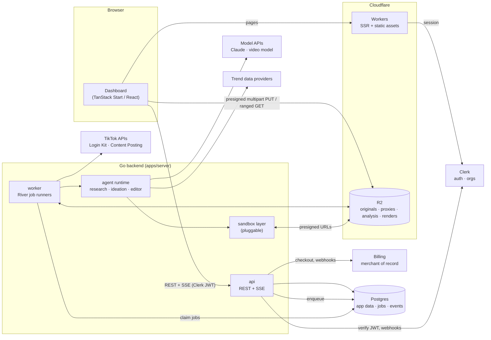
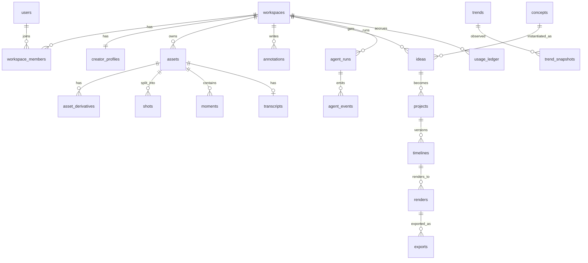
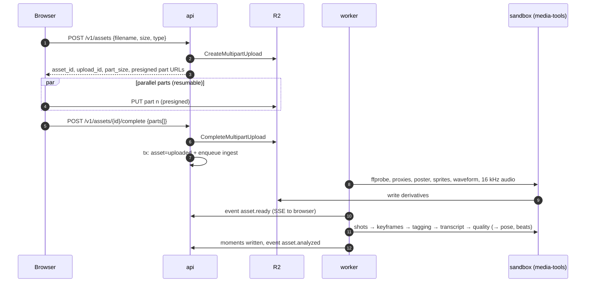

# 03 — Technical Architecture

> Status: **draft v0.1** · 2026-10-16
> This document describes the *shape* of the system. Technology choices and their rationale live in the [decision log](05-decisions.md) (`D-xx`), with evidence in the [research report](02-research.md).

## 1. Goals and constraints

- **Multi-tenant SaaS** for fitness creators; TikTok-only in v1 ([product plan](01-product-plan.md)).
- **Agents must be steerable and reliable**: deterministic rendering, an inspectable edit spec, clear cost caps.
- **Media heavy**: multi-GB uploads, CPU-bound analysis and rendering, smooth scrubbing in the browser.
- **Planned stack**: TanStack Start (`apps/web`), Go (`apps/server`), Cloudflare (R2, Workers), Clerk, a pluggable agent sandbox. Cloudflare K2 only if a real need appears ([D-05](05-decisions.md#d-05-realtime-updates-sse-from-go-k2-deferred)).
- **EU-first**: the founder and early users are EU-based, so data stays in EU regions where the vendor allows ([D-15](05-decisions.md#d-15-eu-data-residency)).

## 2. System overview



**Request path.** The browser talks to Cloudflare Workers for pages and to the Go API for data. Media bytes never pass through the API: the browser uploads to R2 with presigned URLs and plays proxies straight from R2.

**Work path.** The API writes rows and enqueues jobs **in the same Postgres transaction**. Workers claim jobs, process media, run agents and append events. The API streams those events to the browser over SSE.

## 3. Components

| Component | Runs on | Responsibility |
|---|---|---|
| `apps/web` | Cloudflare Workers ([D-09](05-decisions.md#d-09-hosting)) | Dashboard UI, SSR, Clerk sign-in, upload client, player/timeline UI |
| `api` (Go binary) | EU servers behind Cloudflare Tunnel ([D-09](05-decisions.md#d-09-hosting)) | REST API (OpenAPI 3.1), SSE, presigning, webhooks (Clerk, billing, TikTok), quota checks |
| `worker` (Go binary) | EU servers; horizontally scalable; burst to Cloudflare Containers | Job runners: ingest, analysis, render, agent runs, trend scans, cleanup |
| `media-tools` image | `hardened` sandbox (gVisor) on the workers; also the base for the agent escape-hatch sandbox | ffmpeg 8 + Python tools (scene detection, MediaPipe pose, Beat This! beat tracking, transcription). Only permissive licences ([D-16](05-decisions.md#d-16-licensing-policy-for-ml-and-media-components)) |
| `sandbox-gateway` Worker | Cloudflare Workers | Thin shim the Go `cloudflare` sandbox provider calls to create, exec in and destroy Cloudflare Sandboxes; holds the R2 credentials (`S3Gateway`) |
| Postgres | Managed ([D-01](05-decisions.md#d-01-database-postgres-from-day-one-skip-d1-for-the-go-backend)) | System of record, job queue (River), agent event log |
| R2 | Cloudflare | All media and large artefacts |
| Clerk | SaaS | Users, sessions, organizations (workspaces) |
| Billing | Merchant of record: Stripe MoR or Paddle ([D-13](05-decisions.md#d-13-billing)) | Checkout, subscriptions, EU VAT and sales tax; webhooks → plans and entitlements in Postgres |
| Model APIs | SaaS | Claude for agents and tagging; a video-native model where it wins ([D-10](05-decisions.md#d-10-video-understanding)) |

### Repository layout

```
apps/
  web/                     # TanStack Start app (dashboard)
  server/                  # Go module github.com/nilpntr/content-fabrique
    cmd/
      api/                 # HTTP API + SSE
      worker/              # River workers (ingest, analysis, render, agents, trends)
      cfctl/               # admin CLI: migrate, seed taxonomy, replay agent runs, run evals
    internal/
      config/ telemetry/   # env config, slog + OpenTelemetry
      httpapi/             # handlers, middleware (auth, tenancy, rate limit), OpenAPI glue
      auth/                # Clerk JWT verification, Clerk webhooks (Svix)
      store/               # pgx pool, sqlc queries, migrations
      jobs/                # River job args, worker registration, periodic jobs
      storage/             # R2 (S3 API) client, presign, multipart, key layout
      media/               # ffprobe/ffmpeg wrappers: proxies, sprites, waveforms, keyframes
      analysis/            # shots, tagging, transcription, quality, pose; moment builder
      timeline/            # spec types, JSON Schema, validation, edit ops, diff
      render/              # timeline → ffmpeg compiler, profiles, text & captions
      agents/
        runtime/           # loop, tool registry, budgets, events, cancellation
        llm/               # provider interfaces; Anthropic impl; video-model impl
        editor/ research/ ideation/
      trends/              # provider adapters, normalisation, snapshots
      sandbox/             # Provider interface + implementations
      events/              # event log + SSE broker (LISTEN/NOTIFY)
      billing/             # plans, quotas, usage ledger
      tiktok/              # Login Kit OAuth, Content Posting API client
packages/
  schemas/                 # timeline JSON Schema + OpenAPI spec (single source of truth)
  media-tools/             # Dockerfile + Python CLI for the media/sandbox image
infra/                     # IaC: Cloudflare (R2, DNS, Workers), backend hosts
docs/
```

## 4. Data model

Postgres, every tenant-owned row carries `workspace_id`. IDs are UUIDv7, which is time-sortable. Simplified:



| Table | Key columns (abridged) |
|---|---|
| `workspaces` | `id`, `clerk_org_id`, `name`, `plan`, `region` |
| `users`, `workspace_members` | `clerk_user_id`, `email`; `role` (owner, editor, viewer) |
| `creator_profiles` | `niche` (jsonb: sub-niches), `audience_regions`, `tone`, `language`, `brand` (fonts, colours, logo asset), `defaults` (caption style, fps) |
| `assets` | `kind` (video, audio, image), `status` (uploading → uploaded → processing → ready / failed), `r2_key`, `size_bytes`, `sha256`, `duration_ms`, `width`, `height`, `fps`, `rotation`, `codecs`, `has_audio` |
| `uploads` | `asset_id`, `r2_upload_id`, `part_size`, `expires_at` (multipart state for resume) |
| `asset_derivatives` | `kind` (proxy_720, proxy_360, poster, sprite, sprite_vtt, waveform, audio_16k, keyframe), `r2_key`, `meta` |
| `shots` | `asset_id`, `idx`, `start_ms`, `end_ms`, `keyframe_key`, `signals` (blur, exposure, motion) |
| `moments` | `asset_id`, `start_ms`, `end_ms`, `source` (analysis, user, agent), `labels[]`, `attrs` (exercise, muscle_group, pose, rep_index, framing, quality), `description`, `search` (tsvector), `embedding` (optional, [D-10](05-decisions.md#d-10-video-understanding)) |
| `transcripts` | `asset_id`, `language`, `words` (jsonb: word, start_ms, end_ms, confidence) |
| `annotations` | `target_type` (asset, render), `target_id`, `start_ms`, `end_ms`, optional `pin` (normalised x/y point or box on the frame, FrameJam-style), `kind` (comment, include, exclude, prefer, instruction), `body`, `status` (open, applied, resolved), `author_id`, `applied_in_run_id` |
| `trends`, `trend_snapshots` | `kind` (sound, hashtag, format, topic), `external_id`, `title`, `meta` (bpm, snippet window, region); snapshots: `observed_at`, `rank`, `metrics`, `source` |
| `concepts` | Global or per-workspace format templates: `structure` (slots, durations, text roles), `evidence`, `tags` |
| `ideas` | `concept_id`, `hook`, `rationale`, `slot_plan` (slot → moment candidates), `sound_trend_id`, `status` |
| `projects` | `idea_id`, `title`, `brief`, `status` (draft, editing, review, approved, exported), `current_timeline_id` |
| `timelines` | `project_id`, `version`, `spec` (jsonb), `schema_version`, `parent_id`, `author` (user or run), `change_summary`. Immutable once written. |
| `renders` | `timeline_id`, `profile` (preview, final), `status`, `r2_key`, `time_map` (output ms → timeline item), `cpu_ms`, `error` |
| `agent_runs` | `agent` (research, ideation, editor), `status` (queued, running, waiting_input, succeeded, failed, cancelled), `input`, `output`, `model`, token counts, `cost_micros`, `budget_micros` |
| `agent_events` | `run_id`, `seq`, `type` (status, progress, tool_call, tool_result, message, artifact, error), `payload`. Streamed to the UI. |
| `usage_ledger` | `kind` (agent_cost, render_seconds, analysis_minutes, storage_gb_days, sandbox_seconds), `quantity`, `cost_micros`, `ref` |
| `integrations` | `provider` (tiktok), `external_account_id`, `scopes`, encrypted tokens, `expires_at` |
| `exports` | `render_id`, `destination` (download, tiktok_draft), `status`, `external_id` |

**Tenancy.** Every query goes through repository functions that take a `WorkspaceID` resolved from the verified token, never from user input. Integration tests assert that cross-tenant reads fail. R2 keys are prefixed by workspace: `ws/{workspace_id}/assets/{asset_id}/original`, `…/proxy_720.mp4`, `…/renders/{render_id}.mp4`.

## 5. Media pipeline



**Upload.** S3-compatible multipart upload straight to R2, with presigned part URLs from the API.
- **Limits** ([research §5.3](02-research.md#53-r2-storage)): parts of 5 MiB–5 GiB, up to 10,000 parts. We use 16–64 MiB parts.
- **CORS:** the bucket needs a rule allowing `PUT` from our web origins and **exposing the `ETag` header**, because completing a multipart upload needs every part's ETag.
- **Resume:** the client uses a resumable multipart uploader (Uppy's S3 multipart plugin pointed at our endpoints, or a small custom client) and keeps `upload_id`, so a reload can resume.
- **Clean-up:** a job aborts unfinished uploads. R2 also aborts incomplete multipart uploads after 7 days by default.
- **EU buckets** are presigned against the EU jurisdiction endpoint ([D-15](05-decisions.md#d-15-eu-data-residency)).

**Ingest.** Produces everything the UI needs to scrub smoothly. Each job is idempotent (keyed by `asset_id` + derivative kind):
- `proxy_720.mp4`: H.264, 720p long edge, **keyframe every ~1 s**, `+faststart`. Smooth seeking in a plain `<video>`, cheap to render previews from.
- `poster.jpg`, sprite sheet (for example 1 frame/s, 160 px tiles) + WebVTT thumbnails track for hover scrubbing.
- `waveform.json` (peaks) for the timeline, and `audio_16k.wav` for speech recognition.
- Rotation and colour metadata normalised (phone footage is often rotated or HDR; tone-map HDR to SDR for proxies).

**Analysis** turns raw footage into a searchable clip index. The default is a cheap-first hybrid; the choice of models is [D-10](05-decisions.md#d-10-video-understanding).
1. **Shots.** Scene/shot boundaries (PySceneDetect or ffmpeg's `scdet`; TransNetV2 only if its licence passes [D-16](05-decisions.md#d-16-licensing-policy-for-ml-and-media-components)). Most phone clips are one continuous shot, so shots are further split by motion and pose changes.
2. **Signals per shot.** Sharpness, exposure, stability; optionally pose keypoints and rep segmentation for exercise clips (v1).
3. **Tagging.** Sampled keyframes go to a small vision model (Claude Haiku 5.5 by default, validated on eval set #1) with a **fitness taxonomy** (exercise, muscle group, equipment, pose name, camera framing, setting, people count, on-screen text). The output is structured JSON and is validated.
4. **Speech.** Word-level transcript for talking clips (captions, hooks, quotes).
5. **Moments.** Merge the above into `moments` with labels, descriptions, quality scores and full-text search (optional embeddings). User annotations become moments too (`source=user`).

All CPU/ML steps run in the `media-tools` image inside the sandbox layer (§8), because they parse untrusted user files.

## 6. Timeline spec and renderer

**Core design decision ([D-02](05-decisions.md#d-02-edit-representation-declarative-timeline-json--deterministic-renderer)).** Agents and users edit a **declarative timeline (an EDL in JSON)**. A deterministic Go compiler turns it into an ffmpeg graph. The LLM never writes raw ffmpeg in the main path. This gives us:
- **Validation before render** (bad ranges, overlaps, durations, text outside safe zones).
- **Inspectable, diffable versions**, which the UI can show and the user can tweak.
- **Precise revisions**: a comment at 0:04–0:06 of a render maps through `renders.time_map` to the exact timeline item.
- **Reproducibility**: the same spec + assets always give the same output, which makes golden tests possible.
- **Portability**: the same spec can later drive an in-browser live preview or another renderer.

### Spec (v1, abridged)

```json
{
  "schema": "contentfabrique.timeline/v1",
  "output": { "width": 1080, "height": 1920, "fps": 30, "background": "#000000" },
  "tracks": [
    {
      "id": "main", "type": "video",
      "items": [
        {
          "id": "c1", "asset_id": "ast_01J…", "moment_id": "mom_01J…",
          "source": { "in_ms": 3200, "out_ms": 5400 },
          "at_ms": 0, "speed": 1.0,
          "reframe": { "mode": "cover", "focus": { "x": 0.52, "y": 0.40 }, "zoom": 1.08 },
          "look": { "preset": "punchy" },
          "transition_in": { "type": "cut" },
          "audio": { "use_source": false },
          "why": "Best back double-biceps pose; the brief asks to open on it"
        }
      ]
    },
    {
      "id": "text", "type": "text",
      "items": [
        { "id": "t1", "at_ms": 0, "duration_ms": 2200, "text": "How to grow a back 101",
          "style": "title_bold", "anchor": "upper_third", "animation": "pop_in" }
      ]
    },
    { "id": "captions", "type": "captions", "from": "transcript", "style": "word_highlight", "enabled": false },
    {
      "id": "sound", "type": "audio",
      "items": [
        { "id": "s1", "kind": "trend_sound", "trend_id": "trd_01J…", "at_ms": 0,
          "source_offset_ms": 12000, "export": "cue_only", "gain_db": -3 }
      ]
    }
  ],
  "markers": [ { "at_ms": 2200, "kind": "beat", "strength": 1.0 } ],
  "meta": { "idea_id": "ide_01J…", "concept_id": "con_01J…" }
}
```

- **Times are integer milliseconds**, snapped to output frames at compile time. One primary video track in v1; overlays and text go on their own tracks.
- **Audio items have an export policy** ([D-03](05-decisions.md#d-03-music-cue-only-by-default)).
  - `cue_only` sounds are **never reproduced by us**, neither in previews nor in exports. Previews play a generated **beat-guide track** (clicks on beats, accents on downbeats and the drop), so the creator can feel the cut rhythm.
  - `licensed` items (stock library, creator-owned audio) are mixed in normally.
  - The beat grid itself comes from provider metadata (tempo, first-beat offset), from analysis of audio we are allowed to process, or from a tap-tempo fallback in the UI ([research §1](02-research.md#1-tiktok-trend-data-and-music-licensing)).
- **Validation rules** (Go + JSON Schema, shared with the web app via `packages/schemas`): in/out inside the asset duration; no gaps or overlaps on `main` unless intended; minimum shot length; total length within limits; text inside TikTok's UI-safe area; fonts from an allow-list.

### Edit operations

Agents (and the UI) change timelines through **high-level ops**, never by rewriting the whole document. Each call is validated atomically and produces a new immutable version:

`add_clip`, `remove_item`, `move_item`, `trim_item`, `replace_source`, `set_speed`, `set_reframe`, `add_text`, `update_text`, `set_transition`, `set_sound`, `snap_cuts_to_beats`, `set_look`, `set_captions`.

### Renderer

`internal/render` compiles a spec into one ffmpeg invocation per render (`-filter_complex`):
- Per item: `trim/atrim` → `setpts` (speed) → scale/crop to 9:16 around the focus point → fps conversion → look (`eq`/`curves`/`lut3d`) → transitions (`xfade`).
- Text: `drawtext` for simple text; **ASS subtitles via libass** for styled and animated text and word-highlight captions.
- Audio: source audio and licensed tracks mixed (`amix`/`adelay`/`volume`) and normalised (`loudnorm`).
- **Profiles**:
  - `preview`: 540×960, rendered from proxies, very fast encoder preset, with a watermark. Target: seconds for a 30 s edit.
  - `final`: 1080×1920 from originals, high-quality CRF H.264 + AAC, `+faststart`.
  - CPU x264 is enough at our volumes: rendering costs fractions of a cent per short ([research §3.3](02-research.md#33-rendering)).
- Output includes `time_map` (output ms → item id) for comment mapping, and a **contact sheet** (frames at every cut) that the Editor agent uses to check its own work cheaply.
- **Golden tests**: a fixture set of specs rendered in CI, compared by frame hashes or SSIM.

**Later:** an in-browser live preview that plays proxies according to the spec (no server render for small tweaks), and a motion-graphics layer on HyperFrames (HTML-based, Apache-2.0) for richer titles and kinetic captions ([research §3](02-research.md#3-editing--rendering-stack-and-competitors)).

## 7. Agents

### 7.1 Runtime ([D-07](05-decisions.md#d-07-agent-runtime-go-native-loop-on-the-claude-messages-api))

A Go-native agent loop on the Claude Messages API (`anthropic-sdk-go`, using its beta tool runner or a hand-written loop):
- **Tool registry** with typed JSON-Schema tools (`strict: true`). Tool calls and results are persisted as `agent_events` and streamed to the UI ("Looking for your best back pose…").
- **Budgets per run**: token and $ caps (`budget_micros`), a wall-clock timeout and a maximum number of tool calls. They are checked before every model request, and costs go to the `usage_ledger`.
- **Pause and resume**: an `ask_user` tool moves the run to `waiting_input`. The user's reply resumes it. Runs are River jobs, so they survive restarts. The loop is append-only, so a replay rebuilds state from `agent_events`.
- **Prompt caching**: a stable system prompt and tool list come first (cached), and per-run context comes after.
- **Model routing** (see [research §4](02-research.md#4-agent-runtime-and-sandboxes) and the cost model in §13):
  - Claude Opus 5.5 is the default and quality reference for editor runs.
  - Claude Haiku 5.5 handles bulk frame tagging.
  - A video-native model is used only where it wins.
  - Moving editor steps to Sonnet 5.5 or Haiku 5.5 is a **founder decision after the P4 evals**: it is the main unit-economics lever.
- **Provider interface** (`agents/llm`), so a second model vendor can be added without touching agent code.

### 7.2 Editor agent

| Tool | Purpose |
|---|---|
| `get_brief()` | Creator profile, idea/concept, brief text, annotations as constraints (include, exclude, prefer), output limits |
| `search_moments(query, filters)` | Full-text and attribute search over the clip index (exercise, pose, quality, asset) |
| `view_moment(id, frames≤8)` | Sampled low-res frames as images, so the model judges visually |
| `get_sound(trend_id)` | Tempo, beats, downbeats, sections, recommended start, licence policy |
| `get_timeline()` | Current spec + validation warnings |
| `edit_timeline(ops[])` | Apply the ops in §6 atomically; returns the new version and warnings ("cut 40 ms off beat") |
| `render_preview()` | Fast preview + contact sheet image for self-checking |
| `ask_user(question, options)` | Only when truly blocked |
| `finish(summary, open_questions)` | Ends the run with an explanation for the UI |
| `sandbox_exec(...)` *(flagged)* | Escape hatch: run ffmpeg/Python in the sandbox to create a derived asset (custom effect) the timeline can reference |

**The revision loop.** A creator's comment on a preview, a time range or a spot pinned on the frame, is stored as an `annotation` on the render. `time_map` resolves it to timeline items. The next editor run receives:
- "comment X applies to item c3 (lat pulldown clip)";
- **the frame image with the pin drawn on it**, so "make *this* text bigger" is unambiguous.

It then patches only what is needed. This is the review loop popularised by [FrameJam](https://github.com/moritzkremb/framejam), which the README links to: a reviewer points at the frame and says what to change, and the coding agent gets the timestamp plus an annotated frame over MCP ([research §3](02-research.md#3-editing--rendering-stack-and-competitors)). We build it into the product instead of a local tool.

**Guardrails.** Annotations of kind `exclude` are enforced by the validator, not only by the prompt. Every tool input is schema-validated. User text, transcripts, on-screen text and web content are treated as untrusted data in prompts: they are delimited and never treated as instructions that widen permissions.

### 7.3 Research agent and ideation

- **Daily trend scan** (River periodic job per audience region). The agent calls provider tools ([D-11](05-decisions.md#d-11-trend-data-sources)) and web search, then writes `trends`, `trend_snapshots` and `concepts` with evidence links. Its output is **shared across workspaces**, so its cost is amortised over all tenants.
- **Sound metadata** (tempo, beat grid, popular-snippet window) comes from the provider or from our own analysis of audio we are allowed to process ([D-03](05-decisions.md#d-03-music-cue-only-by-default)).
- **Ideation** is a short structured-output run: creator profile + clip-index summary + trend board → N idea cards, each with a slot → moment mapping (with a `search_moments` tool so ideas only use clips that exist).

### 7.4 Evaluation (quality gates for prompts and models)

Agent quality is the product, so every prompt, model or tool change runs the eval suites (`cfctl eval …`) before release:

| Layer | What is checked | How |
|---|---|---|
| **Analysis** (eval set #1) | Exercise, pose and framing tags; best-moment picks; shot boundaries | Labelled clips → precision/recall per label; cost per footage-minute |
| **Hard constraints** (eval set #2) | The brief's ordering, title and required clips are honoured; `exclude` annotations respected; duration limits; text inside safe zones; cuts within ±1 frame of beats when beat-synced | Deterministic checks on the timeline JSON (no model needed) |
| **Edit quality** | Hook strength in the first 2 s, pacing, clip quality, coherence with the concept, text legibility | LLM-judge rubric (1–5 per dimension) on the contact sheet + timeline, calibrated against human ratings |
| **Human review** | Would the creator post it? | Weekly blind rating of sampled beta edits; failures added to the eval sets |
| **Efficiency** | $ per run, wall clock, tool calls, revisions needed | From `agent_runs` / `usage_ledger` |

**Gate:** ≥ 80 % hard-constraint pass rate, no regression in judge scores beyond noise, and cost per run within budget.

## 8. Sandbox layer ([D-08](05-decisions.md#d-08-sandbox-pluggable-interface-default-provider))

Every process that touches untrusted media or runs agent-written commands goes through one interface:

```go
package sandbox

type Provider interface {
	Name() string
	Create(ctx context.Context, spec Spec) (Sandbox, error)
}

type Spec struct {
	Image    string            // e.g. "media-tools:2026.10"
	CPU      float64           // vCPUs
	MemoryMB int
	DiskGB   int
	GPU      string            // "" = none
	Timeout  time.Duration     // hard wall-clock limit
	Env      map[string]string // never long-lived secrets
	Egress   EgressPolicy      // deny-all by default; allow-list (R2 endpoint, model APIs if needed)
	Labels   map[string]string // workspace_id, run_id, job kind (for billing and audit)
}

type Sandbox interface {
	ID() string
	Exec(ctx context.Context, cmd Cmd, out io.Writer) (ExitStatus, error) // streams stdout/stderr
	Download(ctx context.Context, srcURL, dstPath string) error          // pull input via presigned GET
	Upload(ctx context.Context, srcPath, dstURL string) error            // push output via presigned PUT
	WriteFile(ctx context.Context, path string, r io.Reader) error
	ReadFile(ctx context.Context, path string) (io.ReadCloser, error)
	Close(ctx context.Context) error                                      // always destroy; no reuse across tenants
}
```

- **Bytes flow R2 ↔ sandbox directly through short-lived presigned URLs.** The Go worker only passes URLs, so it never proxies gigabytes.
- **Implementations** ([D-08](05-decisions.md#d-08-sandbox-pluggable-interface-default-provider)):
  - `docker`: local development.
  - `hardened`: gVisor (`runsc`) containers on our worker hosts, for **all deterministic media jobs**.
  - `cloudflare`: the Cloudflare Sandbox SDK via the `sandbox-gateway` Worker, the **default for the agent escape hatch**. Internet is disabled, and the job's R2 prefix is mounted with the Worker signing requests, so **no credentials inside**.
  - Alternatives behind the same interface: E2B (Firecracker), and **Claude Managed Agents** for free-form sessions where Anthropic runs the loop. Tools then run in Anthropic's cloud container or on our `hardened` hosts via the Go environment worker.
- **Security**: one sandbox per job (never shared across workspaces); non-root; read-only root filesystem except `/work`; CPU/memory/disk/time limits; egress deny-by-default; no long-lived credentials inside (only presigned URLs scoped to the job's own keys); audit log of every `Exec`.

## 9. API

REST + JSON, contract-first in **OpenAPI 3.1** (`packages/schemas/openapi.yaml`). From it we generate a typed TS client (`openapi-typescript` + `openapi-fetch`, used with TanStack Query) and Go server interfaces (`oapi-codegen`). Auth is a Clerk session JWT in `Authorization: Bearer` ([D-12](05-decisions.md#d-12-auth--tenancy-clerk-organizations-as-workspaces)).

| Area | Endpoints (v1) |
|---|---|
| Me & profile | `GET /v1/me` · `GET/PUT /v1/profile` |
| Assets | `POST /v1/assets` (init multipart) · `POST /v1/assets/{id}/parts` (more presigned parts) · `POST /v1/assets/{id}/complete` · `DELETE /v1/assets/{id}/upload` (abort) · `GET /v1/assets` · `GET /v1/assets/{id}` (with derivative URLs) · `DELETE /v1/assets/{id}` |
| Moments & search | `GET /v1/assets/{id}/moments` · `GET /v1/moments?q=…&exercise=…` |
| Annotations | `GET/POST /v1/annotations` · `PATCH/DELETE /v1/annotations/{id}` |
| Trends | `GET /v1/trends?kind=sound\|format&region=…` · `GET /v1/trends/{id}` |
| Ideas | `POST /v1/ideas:generate` → run · `GET /v1/ideas` · `PATCH /v1/ideas/{id}` |
| Projects | `POST /v1/projects` (from idea or brief) · `GET /v1/projects/{id}` · `POST /v1/projects/{id}/edit` (start or continue an editor run with instructions) |
| Timelines & renders | `GET /v1/projects/{id}/timelines` · `GET /v1/timelines/{id}` · `POST /v1/projects/{id}/timelines` (manual ops → new version) · `POST /v1/timelines/{id}/renders` (preview or final) · `GET /v1/renders/{id}` |
| Runs | `GET /v1/runs/{id}` · `GET /v1/runs/{id}/events` (SSE) · `POST /v1/runs/{id}/reply` · `POST /v1/runs/{id}/cancel` |
| Exports | `POST /v1/renders/{id}/exports` (download or tiktok_draft) · `GET /v1/exports/{id}` |
| Stream | `GET /v1/stream` (SSE: workspace-wide events for the dashboard) |
| Webhooks | `POST /webhooks/clerk` · `POST /webhooks/billing` · `POST /webhooks/tiktok` |

Conventions: cursor pagination; `Idempotency-Key` on POSTs that create work; `problem+json` errors; per-workspace rate limits and quotas checked before enqueueing.

## 10. Realtime updates ([D-05](05-decisions.md#d-05-realtime-updates-sse-from-go-k2-deferred))

- Workers append to `agent_events` (and small status events for assets and renders) and `NOTIFY` a channel. The API holds SSE connections and forwards matching events per workspace.
- **Resumable**: every event has a monotonically increasing id; clients reconnect with `Last-Event-ID` and the API replays from Postgres.
- **Heartbeats** every ~20 s keep connections alive through proxies. The browser uses a fetch-based SSE client, so the Clerk token can go in the `Authorization` header.
- **Cloudflare K2 is not needed for v1**: event volume is small and already durable in Postgres. Revisit it if we add high-volume analytics events or need fan-out beyond the API instances ([research §5](02-research.md#5-platform-cloudflare-clerk-go-costs)).

## 11. Auth, tenancy, billing

- **Clerk** for sign-up, sign-in and sessions in the web app (TanStack Start SDK). The Go API verifies the session JWT with the Clerk Go SDK v2 (`clerkhttp.RequireHeaderAuthorization`, then `clerk.SessionClaimsFromContext`) and resolves `workspace_id` from the active organization.
- **Clerk webhooks** (Svix-signed) keep `users`, `workspaces` and memberships in sync. They are processed idempotently.
- **Billing** ([D-13](05-decisions.md#d-13-billing)):
  - Payments run through a **merchant of record** (Stripe's MoR product or Paddle), which handles EU VAT and sales tax. Clerk stays identity-only.
  - Plans map to quotas (exports per month, storage, concurrent jobs, agent budget).
  - Every billable action writes to `usage_ledger`, and quotas are checked before work is enqueued. Agent runs carry hard `$` budgets.

## 12. Deployment, environments, observability

- **Environments**: `local` (docker compose: Postgres, MinIO or a dev R2 bucket, worker, api; web via Vite), `staging`, `production`. Separate Clerk instances, R2 buckets and DB branches per environment.
- **Hosting** ([D-09](05-decisions.md#d-09-hosting)):
  - Web on Cloudflare Workers.
  - Go `api` and `worker` on EU servers (e.g. Hetzner) as containers, reachable only through **Cloudflare Tunnel**.
  - Workers are horizontally scalable, with per-queue concurrency limits: render and analysis are CPU-bound, agent runs are I/O-bound.
  - When queues back up, burst render and analysis onto Cloudflare Containers with the same image.
- **CI/CD** (GitHub Actions):
  - lint + test for Go and web, render golden tests, and OpenAPI drift check;
  - build the images (`api`, `worker`, `media-tools`) and deploy;
  - Renovate for dependencies;
  - migrations run as a release step.
- **Observability**: structured logs (`slog`) + OpenTelemetry traces and metrics. One trace spans API → job → agent turns → sandbox exec. Export goes to a managed backend (e.g. Axiom or Grafana Cloud), with error tracking in the web app. Dashboards: queue depth and latency per job type, render time per output minute, agent cost per run, failures by tool.
- **Agent observability**: every run has a replayable event log, plus an admin view to inspect prompts, tool calls, cost and the resulting timeline.

## 13. Cost model

These are unit-cost **estimates** for budgeting. List prices are from October 2026 ([research §5.8](02-research.md#58-cost-model-inputs-oct-2026-list-prices)); the volumes are assumptions to replace with real `usage_ledger` data during the beta.

| Item | Assumption | Estimate |
|---|---|---|
| **Editor agent, first edit** | ~12 turns. Prompt caching on (≈ 50k cache-write + ≈ 350k cache-read tokens). ≈ 20k output tokens including thinking. | **≈ $0.40 on Sonnet 5.5** ($2/$10, cache reads $0.20) · ≈ $0.70 on Opus 5.5 ($4/$20) · ≈ $0.03 on Haiku 5.5 if evals show it is good enough |
| Editor agent, revision | ~5 turns, targeted ops | ≈ $0.10–0.20 (Sonnet 5.5) |
| Ideation | 1 structured run with a moment-search tool | ≈ $0.03–0.06 |
| Clip tagging | 30 keyframes per footage-minute × ~700 tokens, Haiku 5.5 | ≈ $0.003 per footage-minute |
| Rendering | Preview from proxies + final 1080×1920, ~60 s of 4 vCPU | ≈ $0.005 on Cloudflare Containers; less on our own servers |
| Storage | ~5 GB originals + proxies per active creator per month, R2 Standard, no egress fees | ≈ $0.08 per creator-month |
| Research agent | Shared across tenants: ~50 web searches ($10 per 1k) + ~1M tokens per region per day | ≈ $1–5 per region-day, not per user |
| Agent escape hatch | Cloudflare Sandbox, 2 vCPU for 5 min (+ memory) | ≈ $0.02 per run, billed as credits |

**Roll-up per exported video** (1 first edit + 2 revisions + ideation + 10 footage-minutes of tagging + renders + storage share):

| Model mix for editor runs | ≈ COGS per exported video |
|---|---|
| **Opus 5.5 throughout (default, quality reference)** | **$1.00–1.20** |
| Opus 5.5 first edit + Sonnet 5.5 revisions | $0.85–0.95 |
| Sonnet 5.5 throughout | $0.60–0.70 |
| Sonnet 5.5 first edit + Haiku 5.5 revisions and routine steps | $0.45–0.55 |
| Haiku 5.5 throughout | $0.10–0.15 |

**Model tokens dominate COGS**; compute and storage are noise.

**Unit economics need a founder decision.** With Opus 5.5 on every edit (≈ $1.10 per video), the Creator plan (€29 for 20 videos ≈ €1.45 per video) is far above the ~25 % COGS guardrail in the [product plan §10](01-product-plan.md#10-pricing-hypothesis). The options are:
1. Route editor steps to Sonnet 5.5 or Haiku 5.5 **where the P4 evals show they match Opus 5.5** on the quality gates (§7.4).
2. Price per video higher.
3. A mix of both.

The beta measures real cost per exported video, then the founder picks the routing. The v1 target is **< $0.30 per exported video**.

**Cost levers, in order:** prompt caching; fewer and denser turns (contact sheets instead of many `view_moment` calls); effort tuning per route; model routing per the decision above; the shared research cost.

## 14. Security and privacy

- **Data**: the EU region for the database and R2 where available ([D-15](05-decisions.md#d-15-eu-data-residency)); encryption at rest (provider default) and in transit; short-lived presigned URLs; no public buckets.
- **Secrets**: only in the API and worker; never in sandboxes or prompts; rotated through the platform secret store.
- **Prompt injection**: user text, transcripts, OCR'd on-screen text and web/trend content are untrusted. Delimit them in prompts, keep tool permissions fixed, and treat a model's request to do something outside its tools as a no-op.
- **Abuse**: per-workspace rate limits and quotas; upload type and size checks; malware-safe media parsing inside sandboxes; a takedown process.
- **GDPR**: data processing agreements with every processor (Cloudflare, Clerk, the database host, model providers); a records-of-processing list; retention (delete originals N days after export, configurable); account deletion cascades to R2; **no training on customer content**.
