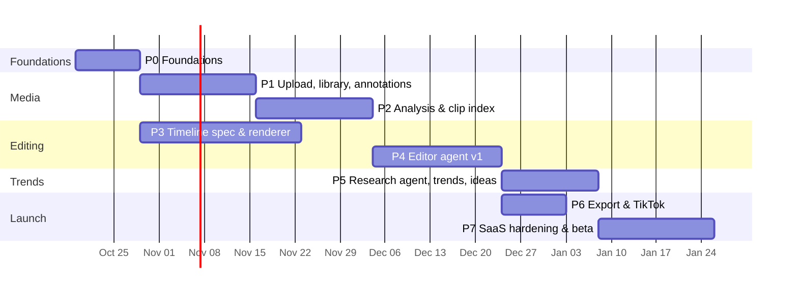

# 04 — Implementation Plan

> Status: **draft v0.1** · 2026-10-16
> How we get from an empty repo to a private beta with 10–20 fitness creators. Phases are ordered by dependency. Every task is sized to be **one PR** (and fits a single Claude Code session). Task IDs (`P1-03`) are meant to become GitHub issues.
> Read with: [product plan](01-product-plan.md) · [architecture](03-architecture.md) · [decisions](05-decisions.md) · [research](02-research.md)

## 0. Current state (2026-10-16)

- `README.md` with the product idea; `apps/server/go.mod` (`module github.com/nilpntr/content-fabrique`, Go 1.27.2).
- ⚠️ **`apps/web` is not in the repository.** It was committed as a *gitlink* (mode 160000, pointing at commit `e298d18…`) without a `.gitmodules` entry. The base UI never reached GitHub. Most likely `apps/web` had its own `.git` folder (created by the TanStack scaffolder) when the root repo was committed. **Fix (task P0-01):**
  ```bash
  rm -rf apps/web/.git            # or move it aside if its history matters
  git rm --cached apps/web
  git add apps/web && git commit -m "chore(web): add web app sources" && git push
  ```

## Phase overview



The dates are indicative for **one to two engineers working with Claude Code**. P3 runs in parallel with P1–P2 because the renderer only needs fixtures, not the analysis pipeline. **Critical path: P0 → P1 → P2 → P4 → P5 → P7, about 16–18 weeks.**

## P0 — Foundations (≈ 2 weeks)

**Goal:** a signed-in user sees the dashboard shell, and the web app calls the Go API with a verified identity. CI is green and staging is deployed.

| ID | Task | Acceptance criteria |
|---|---|---|
| P0-01 | Fix the `apps/web` gitlink; commit the real UI sources | `git ls-tree HEAD apps/web` shows a tree (not a commit); the app builds in CI |
| P0-02 | Monorepo hygiene: root `Taskfile`/`Makefile`, `.editorconfig`, pnpm workspace for `apps/web` + `packages/*`, Go workspace layout from [architecture §3](03-architecture.md#repository-layout) | `task dev` starts web + api + worker + Postgres locally |
| P0-03 | CI (GitHub Actions): Go (`go vet`, `golangci-lint`, `go test -race`), web (typecheck, lint, test, build), Renovate config | Required checks on `main`; under 10 min |
| P0-04 | Go service skeleton: config, `slog`, OpenTelemetry, `/healthz` + `/readyz`, graceful shutdown, `cmd/api`, `cmd/worker`, `cmd/cfctl` | Binaries build; health endpoints work; traces visible locally |
| P0-05 | Postgres: `pgx` pool, `sqlc`, migrations (`goose` or Atlas), initial schema (workspaces, users, members, profiles) per [D-01](05-decisions.md#d-01-database-postgres-from-day-one-skip-d1-for-the-go-backend) | `cfctl migrate up` works against local and staging |
| P0-06 | River job queue wired into the worker (one demo job, periodic-job support, River UI in staging) | A job enqueued in an API transaction is processed by the worker |
| P0-07 | Clerk: web sign-in (TanStack Start SDK); Go middleware verifying session JWTs; `GET /v1/me`; Clerk webhook endpoint (Svix verify) syncing users and orgs | Signing in on web shows `/v1/me` data; webhook replays are idempotent |
| P0-08 | OpenAPI 3.1 contract in `packages/schemas`; generated TS client (+ TanStack Query hooks) and Go server interfaces; CI drift check | Changing the spec without regenerating fails CI |
| P0-09 | Cloudflare: R2 buckets per env (EU jurisdiction where possible, [D-15](05-decisions.md#d-15-eu-data-residency)), CORS for browser multipart (allow `PUT`, expose `ETag`), lifecycle rule to abort stale multipart uploads sooner than R2's 7-day default; Workers deploy of `apps/web` | Staging URL serves the app; a CORS preflight to R2 passes |
| P0-10 | Backend hosting baseline per [D-09](05-decisions.md#d-09-hosting): EU server(s), `api` and `worker` images, Docker Compose deploy pipeline, secrets, **Cloudflare Tunnel** (no public inbound ports) | `api.staging…/healthz` is reachable only through Cloudflare |
| P0-11 | Observability backend + error tracking; log correlation by `trace_id`, `workspace_id`, `run_id` | One request traceable end to end |
| P0-12 | **Legal kickoff** (in parallel with engineering): music and beat-grid approach, TikTok developer terms for draft uploads, trend-data sources, GDPR/DSA hosting duties, ToS and privacy policy drafts ([research §6](02-research.md#6-limits-of-this-research-and-open-questions)) | Written answers before P5/P6 start |

## P1 — Upload, library, player and annotations (≈ 2.5–3 weeks)

**Goal:** creators upload many large clips reliably, browse them, scrub smoothly and leave comments on time ranges.

| ID | Task | Acceptance criteria |
|---|---|---|
| P1-01 | Assets API: init multipart (`CreateMultipartUpload`), presign part batches, complete, abort; `uploads` table for resume | A 3 GB file uploads with parallel parts; killing the tab and reopening resumes from completed parts |
| P1-02 | Web upload manager (Uppy S3-multipart against our endpoints, or a small custom client): queue, progress, retry, resume | Upload 20 clips at once on a throttled connection; no data loss |
| P1-03 | `media-tools` image v0: ffmpeg 8 + ffprobe; Go `media` package wrappers; `docker` and **`hardened` (gVisor `runsc`)** sandbox providers ([architecture §8](03-architecture.md#8-sandbox-layer-d-08)); licence inventory check in CI ([D-16](05-decisions.md#d-16-licensing-policy-for-ml-and-media-components)) | `cfctl media probe <file>` prints normalised metadata; gVisor overhead on a 1080p transcode measured and recorded |
| P1-04 | Ingest job: probe, validate, `proxy_720.mp4` (1 s GOP, faststart), poster, sprite sheet + VTT, waveform peaks, `audio_16k.wav`; rotation and HDR→SDR handling | iPhone HDR portrait clip → correctly oriented SDR proxy that seeks instantly |
| P1-05 | SSE: `events` package (Postgres `LISTEN/NOTIFY` + replay by `Last-Event-ID`), `GET /v1/stream`; web hook `useWorkspaceEvents()` | Asset status changes appear live; reconnect replays missed events |
| P1-06 | Library UI: grid with posters, duration, status, processing progress; delete | Matches the base UI design |
| P1-07 | Clip view: player over the proxy + timeline (filmstrip from sprites, waveform), keyboard shortcuts (J/K/L, I/O), range selection | Scrubbing a 10-min clip is smooth on a mid-range laptop |
| P1-08 | Annotations: API + UI to create, edit and delete range comments with a kind (comment, include, exclude, prefer) and an optional pin on the frame; list per asset | Annotations persist and render as regions and pins on the timeline |
| P1-09 | Storage accounting + per-plan upload limits (simple version) | Uploads beyond the quota are rejected before presigning |

## P2 — Analysis and clip index (≈ 2.5–3 weeks)

**Goal:** the system knows what is in the footage, so search and agents can find "best back pose" or "lat pulldown reps".

| ID | Task | Acceptance criteria |
|---|---|---|
| P2-01 | **Fitness taxonomy** v1 (exercises, muscle groups, equipment, poses, framings, settings) as versioned YAML in `packages/schemas` + loader | Covers the 150 most common gym exercises and standard bodybuilding poses |
| P2-02 | Shot/segment detection in `media-tools` (tool per [D-10](05-decisions.md#d-10-video-understanding)); `shots` table | On the eval set, boundary F1 ≥ 0.85 |
| P2-03 | Keyframe sampling + quality signals (sharpness, exposure, stability) | Per-shot best frame selected; blurry frames rejected |
| P2-04 | Vision tagging job: batch keyframes → **Claude Haiku 5.5** (escalate ambiguous shots to Sonnet 5.5) with a strict JSON schema based on the taxonomy; retries; cost metered ([D-10](05-decisions.md#d-10-video-understanding)) | Tagging accuracy (exercise/pose) ≥ 80 % on the eval set; cost ≤ $0.005 per footage-minute |
| P2-05 | Transcription job with word timestamps (speech clips only; detect speech first) | Word timing error < 100 ms median on test clips |
| P2-06 | Moment builder: merge shots + tags + transcript + quality into `moments`; full-text search; optional embeddings | `GET /v1/moments?q=back` returns relevant moments ranked by quality |
| P2-07 | Library search UI + moment chips on the clip timeline; user annotations shown as user moments | Search "posing" highlights the matching ranges |
| P2-08 | **Eval set #1**: 50–100 real fitness clips (with consent) labelled with exercise, pose and best moments; `cfctl eval analysis` | Report with precision/recall per label and cost per minute |
| P2-09 | Optional (v1): MediaPipe pose estimation + rep segmentation for exercise clips; pose quality score for posing clips | "Best rep" and "best pose" are chosen by pose score, not only by the vision model |
| P2-10 | **Video-model spike**: a Gemini Flash-class model (low media resolution) and Twelve Labs vs frames-only tagging on eval set #1, comparing accuracy, cost and latency | Decision recorded in [D-10](05-decisions.md#d-10-video-understanding) |

## P3 — Timeline spec and renderer (≈ 3–4 weeks, parallel with P1–P2)

**Goal:** any valid timeline renders deterministically, quickly and correctly. This is the foundation for agent editing.

| ID | Task | Acceptance criteria |
|---|---|---|
| P3-01 | Timeline JSON Schema v1 in `packages/schemas` ([architecture §6](03-architecture.md#6-timeline-spec-and-renderer)); Go types + validation; TS types | Schema tests: 30 valid and 30 invalid fixtures behave as expected |
| P3-02 | Edit-op engine (`add_clip`, `trim_item`, `move_item`, `replace_source`, `add_text`, `set_sound`, `snap_cuts_to_beats`, …) producing immutable versions + diffs | Property tests: ops never produce invalid specs; diffs round-trip |
| P3-03 | Compiler: spec → ffmpeg `filter_complex` (trim, speed, reframe/cover with a focus point, fps, looks, `xfade`, overlays) | 20 fixture specs render; golden frame tests pass in CI |
| P3-04 | Text and captions: ASS generation via libass (title styles, animations, word-highlight captions), font allow-list, **TikTok UI-safe zones** | Text never lands in the unsafe zones; captions stay in sync within 1 frame |
| P3-05 | Audio: source-audio selection, licensed music mix, `loudnorm`; `cue_only` sound items excluded from exports ([D-03](05-decisions.md#d-03-music-cue-only-by-default)) | An export's audio contains no `cue_only` sound (asserted by test) |
| P3-06 | Render jobs + profiles (`preview` from proxies, `final` from originals); `time_map` + contact sheet output; progress events | 30 s edit: preview ≤ 10 s, final ≤ 60 s on the target host |
| P3-07 | Timeline review UI: preview player, track view (read-only first), version list and compare, comment on output ranges or a pinned spot on the frame (mapped through `time_map`) | A comment at 0:04 is linked to the right clip; the agent receives the frame with the pin drawn on it |
| P3-08 | Manual tweak ops in the UI (reorder, trim, swap source, edit text) → new versions | A user can fix a cut without the agent |
| P3-09 | Beat utilities: beat-grid type, cut-to-beat snapping, a tempo-aware duration helper | Snap error ≤ 1 frame |

## P4 — Editor agent v1 (≈ 3 weeks)

**Goal:** from an idea or a brief plus clips, the agent makes a good first edit and revises it from comments.

| ID | Task | Acceptance criteria |
|---|---|---|
| P4-01 | Agent runtime: loop on the Claude Messages API (`anthropic-sdk-go`), typed tool registry (`strict` schemas), persisted events, budgets ($, tokens, tool calls, wall clock), cancel, `ask_user` pause and resume, prompt caching ([D-07](05-decisions.md#d-07-agent-runtime-go-native-loop-on-the-claude-messages-api)) | Kill the worker mid-run and resume without a duplicate side effect; budget overrun stops cleanly |
| P4-02 | Editor tools ([architecture §7.2](03-architecture.md#72-editor-agent)): `get_brief`, `search_moments`, `view_moment`, `get_sound`, `get_timeline`, `edit_timeline`, `render_preview` (+ contact sheet), `finish` | Each tool has unit tests and a JSON-schema contract test |
| P4-03 | Editor system prompt: TikTok fitness editing principles (hook in the first 1–2 s, pacing, beat sync, text legibility and safe zones, duration targets, honouring exclude/include annotations), with versioning | Prompt lives in the repo with a changelog; cache hit rate visible |
| P4-04 | Brief → constraints: parse a free-text brief into structured constraints (ordering, titles, specific clips, sound) shown to the user before editing | The README example ("best back pose → 'How to grow a back 101' → exercise clip + viral song") becomes 3 explicit constraints |
| P4-05 | Revision flow: comments on a preview → targeted editor run → new version + change summary | Typical comment → new preview in under 2 min |
| P4-06 | Run UI: live activity feed (tool steps in plain language), cost and time, stop button, answer `ask_user` | A user always sees what the agent is doing |
| P4-07 | **Eval set #2**: 20–30 scenarios (clip library + brief/idea + expected properties); automatic checks (constraints satisfied, duration, beat alignment, safe zones) + LLM-judge rubric + human rating; `cfctl eval editor` | Baseline recorded; the release gate needs ≥ 80 % pass on hard constraints and no regression on the judge score |
| P4-08 | Escape hatch behind a flag: `sandbox_exec` on **Cloudflare Sandbox** via the `sandbox-gateway` Worker (internet off, R2 prefix mounted, no credentials inside) ([D-08](05-decisions.md#d-08-sandbox-pluggable-interface-default-provider)), producing derived assets usable in timelines | A custom effect (e.g. a speed-ramp montage) works end to end and is billed |

## P5 — Research agent, trend board and ideas (≈ 2–3 weeks)

**Goal:** a fresh, evidence-backed fitness trend board, and ideas that combine trends with the creator's own clips.

| ID | Task | Acceptance criteria |
|---|---|---|
| P5-01 | `trends.Provider` interface + MVP sources per [D-11](05-decisions.md#d-11-trend-data-sources): an admin curation UI (formats and hashtags from manual Creative Center review), web-search research runs, creator TikTok links via oEmbed; licensed music analytics (Chartmetric) adapter once funded; normalisation into `trends`/`trend_snapshots`; rate limits and caching | A daily snapshot for one region is stored; provider outages are tolerated |
| P5-02 | Sound metadata: tempo, beat grid, popular-snippet window. Method per the P0-12 legal answer: provider metadata, analysis of audio we may process, or tap-tempo fallback in the UI | `get_sound()` returns a usable beat grid for ≥ 80 % of the sounds on the board |
| P5-03 | Research agent (periodic, per audience region): classify fitness relevance, extract **concepts** (format templates with slots) with evidence links | The board shows at least 20 relevant formats and sounds, refreshed at least weekly (daily once licensed music data is on), each with "why it works" |
| P5-04 | Trend board UI: sounds and formats, growth sparkline, filters, save to inspiration | — |
| P5-05 | Ideation run → idea cards with slot→moment mapping (only real moments); accept, tweak or reject → project | Ideas reference existing clips 100 % of the time |
| P5-06 | Curated concept library seed (10–20 proven fitness formats) as a fallback when trend data is thin | Ideas still work with zero provider data |

## P6 — Export and TikTok (≈ 1.5–2 weeks)

| ID | Task | Acceptance criteria |
|---|---|---|
| P6-01 | Export package: final MP4 + caption text + hashtags + **sound cue** (sound name/link, start offset), download page | One-click download; the cue matches the timeline |
| P6-02 | Licensed-music option (if chosen in [D-03](05-decisions.md#d-03-music-cue-only-by-default)): catalogue search, licence record per export | Licence id stored with every export that bakes in music |
| P6-03 | TikTok developer app, Login Kit OAuth, encrypted token storage, refresh | A creator can connect and disconnect TikTok |
| P6-04 | Content Posting API: **upload as draft to the creator's inbox**; status polling; error handling; start the app review/audit early | The draft appears in the creator's TikTok inbox |

## P7 — SaaS hardening and private beta (≈ 2.5–3 weeks)

| ID | Task | Acceptance criteria |
|---|---|---|
| P7-01 | Plans, quotas and credit ledger enforcement; billing through a **merchant of record** (Stripe MoR or Paddle) per [D-13](05-decisions.md#d-13-billing); upgrade/downgrade flows | Quota exceeded → clear UI; webhooks idempotent; EU VAT handled by the MoR |
| P7-02 | Onboarding flow (profile, first upload, first idea) + empty states + sample project | A new user exports a first video in < 15 min of their own time |
| P7-03 | Rate limiting, abuse controls, upload validation, takedown process | — |
| P7-04 | Security review: tenancy isolation tests, sandbox escape tests, prompt-injection tests over comments, transcripts and trend text | Findings fixed or accepted with an owner |
| P7-05 | GDPR: privacy policy, DPAs, records of processing, data export and delete, retention jobs | Account deletion removes DB rows and R2 objects within 30 days |
| P7-06 | Load test: 50 concurrent renders + 20 concurrent agent runs; autoscaling or queue limits tuned | p95 preview latency within target under load |
| P7-07 | Dashboards and alerts: queue age, failure rates, cost per run, cost per export | On-call runbook in `docs/` |
| P7-08 | Beta programme: recruit 10–20 fitness creators, in-app feedback, weekly review of failed or low-rated edits → eval set | Weekly metrics from the [product plan §11](01-product-plan.md#11-success-metrics) |

## Cross-cutting practices

- **Contracts first.** OpenAPI and timeline JSON Schema change through PRs, with generated code checked by CI.
- **Testing pyramid.**
  - Go unit tests and table tests; `testcontainers` Postgres for repository tests.
  - Render golden tests; web component tests.
  - Playwright end-to-end for upload → edit → export on staging.
  - Agent evals (P2-08, P4-07) on every prompt or model change.
- **Feature flags** for risky features (sandbox escape hatch, TikTok drafts, new models).
- **Cost visibility** from day one: every model call and render writes to `usage_ledger`; daily cost report per workspace.
- **Docs.** Keep `docs/` current: update [decisions](05-decisions.md) when a choice changes, and add runbooks as services ship.

## Definition of done for the private beta

1. A new creator can sign up, upload clips, get ideas, receive an agent-made edit, revise it with comments and export it (download or TikTok draft), without help.
2. p50 *upload complete → first preview* < 5 min. Median COGS per exported video is measured from `usage_ledger`, and the founder has chosen the model routing for v1 from the P4 eval results ([architecture §13](03-architecture.md#13-cost-model)).
3. Eval gates are green; there are no known cross-tenant or sandbox-escape issues.
4. Billing/quotas are on; the GDPR basics are in place; dashboards and alerts are live.

## Open questions for the founder

1. **Budget** for model APIs, trend-data providers and hosting during the beta (it decides model tiers and provider choices).
2. **Accounts**: are target creators mostly on *personal* or *business* TikTok accounts? This affects the music strategy ([D-03](05-decisions.md#d-03-music-cue-only-by-default)).
3. **Regions**: which audience regions should the trend board cover first (NL, DE, UK, US…)?
4. **Legal entity** for the TikTok developer app and the data processing agreements.
5. **Beta creators**: who are the first 10–20, and can we use (some of) their footage for evals with consent?
6. Is **AI voice-over / generated b-roll** ever in scope? It is a non-goal for v1 and affects later architecture.
7. **Model routing vs price per video** (decide after P4 evals). Claude Opus 5.5 on every edit costs ≈ $1.10 per exported video; routing steps to Sonnet 5.5 or Haiku 5.5 where evals show parity brings it to ≈ $0.15–0.65 ([architecture §13](03-architecture.md#13-cost-model)). Which quality bar and plan prices do we want?
8. **Escape-hatch provider**: Cloudflare Sandbox (default in [D-08](05-decisions.md#d-08-sandbox-pluggable-interface-default-provider)) or Claude Managed Agents, if you want Anthropic to run free-form editing sessions end to end?
